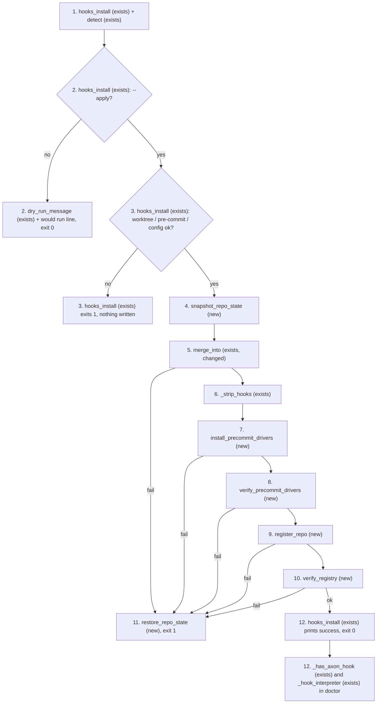

# F0.1 #200: `hooks install --apply` in pre-commit repos installs the driver and registers the repo, or fails

**Approved**: 2026-11-26 - user: "Aprovo (Recommended)" - Sammy (via Otto, a4a62eae-a414-454f-9930-0ee38b7c18d3; Parker db40fbe8), answering "aprova a construção pelo Dani, com PR em rascunho e revisão da Rita?"

- What: plan r2, chain 20261126-axon-competitive, roadmap item F0.1 (issue sammyjdev/axon#200). Owner: Pietro. Status: r2 after Vera's critic review (FAIL, 8 findings), for her delta check, then Otto, then Sammy. Changed since r1: see Revision 2 delta at the end.
- SHA-256: in the result to Otto and in Pietro's work/20261126-axon-competitive/RESULT.md.
- Repo: `sammyjdev/axon` (covered on ClaudeBot `main`). Base: `master` at `f898c82d9746f28c309247416c98f771a201dbc2`. Proposed branch: `fix/200-precommit-hooks-install`. Draft PR; merge is Sammy's.
- Complexity: medium - one CLI branch, a subprocess call to an external tool, a registry write and a doctor reader across three modules; no security, money or data-loss path.
- Flags: none - checked against the triggers: no auth, secrets, user data or external input beyond the user's own repo config (not security); no schema or query (not database); no CI, container or deploy change (not infra). It runs a local `pre-commit install` in the user's repo, which is the documented setup step, not a new dependency (`pre-commit>=3.5.0` is already in `.[dev]`, `pyproject.toml:79`).
- Builder: Dani (Otto's dispatch names Dani; medium complexity).
- Reviewers: Vera (plan, critic gate); Rita (code).
- Tests: atdd - recorded decisions exist: issue #200 (cause, proposed fix, test shape), roadmap F0.1 (approved with D1-D8), and the existing `tests/hooks/test_hooks_cli.py` and `tests/doctor/test_checks_capture_path_registry.py`.
- Authorization: Sammy via Parker 31e511a9, "Aprovo todas (Recommended)" (D1-D8, 2026-11-26); Otto's dispatch 448a7d26 (plan request 2). Sammy's approval of this plan is required before any build. Not approved: merge, release, any change outside this plan.
- Inputs read: `ROADMAP-axon.md` sha256 9d0c14ad8d3f1f71a1c6914ade9c5fe34af2da745e0c286f3400a7cc276a6300; `state.md` 29a9c81144e35144bb4abeb3ae6bcab432946b548a778d3795acecd2c9a2e6a2; `diagnosis.md` 3606fe8efed358d314941a90549009df45ddf764667666fa654c918acea13d25; issue #200 body read with read-only gh on 2026-11-26.

## Problem

In a repo with `.pre-commit-config.yaml`, `axon hooks install --apply` (`hooks_install`, `src/axon/cli/pb.py:997-1097`) takes the `Toolchain.PRE_COMMIT_FRAMEWORK` branch (`pb.py:1048-1058`): it appends AXON's `- repo: local` entries with `merge_into` (`src/axon/hooks/precommit_integration.py:46-66`), prints `[axon] Entries adicionados em <cfg>` and returns with exit 0. It never runs `pre-commit install` for the hook types AXON stages (`post-commit`, `post-merge`; `precommit_integration.py:24,31`), so the entries stay inert, and it never records the repo in `onboarded_repos.json`, which only `install_hooks` writes (`src/axon/hooks/git_installer.py:118-139`). On a second run it prints `AXON entries ja presentes - nada a fazer` and still installs nothing. Doctor cannot see such a repo either: `_onboarded_repos` keeps only repos whose `.git/hooks/post-commit` holds AXON's own marker block (`src/axon/doctor/checks/capture_path.py:38-60,74-81`), which a pre-commit driver never has.

Evidence from #200 (2026-09-11, `glyph-kg`): the command printed the success line, `.git/hooks/` held only `*.sample` files, the registry did not list the repo, and the repo captured nothing while doctor stayed green. Who pays: every user onboarding a repo that uses the pre-commit framework; the cost is zero capture with no signal, found only by accident.

When this ships, `axon hooks install --apply` in a pre-commit repo either leaves working `post-commit` and `post-merge` drivers plus a registry entry, verified, with exit 0, or exits 1 with a message that names what is missing. Doctor lists the repo.

## Shape

Reuses `merge_into` (changed: structural, validated insertion), the registry write that `install_hooks` already does (factored into one helper), and `_strip_hooks` to remove a legacy AXON block; the new rules (preflight, install, verify, restore on failure) run in `axon.hooks.precommit_integration`, reached by `CliRunner` tests and by direct calls. Every `pre-commit` call runs with `cwd=<repo>` and passes `cfg.name`, the repo-relative file name; `cfg` is `.pre-commit-config.yaml` when it exists, else `.pre-commit-config.yml` (`pb.py:1049-1051`, unchanged).

1. `axon hooks install [--apply]` in a repo with either config file -> `hooks_install` (exists) -> `detect` (exists) returns `PRE_COMMIT_FRAMEWORK`.
2. without `--apply`: `hooks_install` (exists) prints `dry_run_message(cfg)` (exists, unchanged) and then, from `hooks_install` only, the `would run:` line of criterion 12; exit 0, no file written.
3. `--apply` preflight, before any write - `hooks_install` (exists): `.git` is a file (worktree) -> exit 1; `shutil.which("pre-commit")` missing -> exit 1; `cfg` must `yaml.safe_load` to a mapping whose `repos` is a list -> otherwise exit 1.
4. `snapshot_repo_state` (new) - keeps the bytes (or absence) of `cfg`, `.git/hooks/post-commit`, `.git/hooks/post-merge`, `.git/hooks/post-commit.legacy`, `.git/hooks/post-merge.legacy` and the registry file.
5. `merge_into` (exists, changed) - when AXON's entries are absent: rewrites a `repos: []` line as `repos:` followed by the entry, or inserts the entry at the end of a block `repos:` list, before the next top-level key; the result must `yaml.safe_load` with hook ids `axon-post-commit` and `axon-post-merge` in a `repo: local` item, else it raises and writes nothing. When present: no write, returns `False`, and `hooks_install` prints `[axon] AXON entries already in <cfg.name>` and continues.
6. `_strip_hooks` (exists, `git_installer.py:149`) - removes AXON's marker block from `post-commit`, `post-merge`, `post-commit.legacy` and `post-merge.legacy`, so pre-commit's legacy (migration) mode does not run capture twice.
7. `install_precommit_drivers` (new) - runs `pre-commit install --config <cfg.name> --hook-type post-commit --hook-type post-merge` (`shell=False`, fixed argv); non-zero -> failure.
8. `verify_precommit_drivers` (new) - each driver exists, contains `--hook-type=<type>` and `--config=<cfg.name>`, and is executable on POSIX; any miss -> failure.
9. `register_repo` (new, factored out of `install_hooks`) - adds the resolved repo root to `load_runtime_config().data_root / "onboarded_repos.json"` (`AXON_ENGINE/data`, `runtime.py:57-58`); an unparseable or non-list file -> failure without writing it (the `install_hooks` path keeps its best-effort contract).
10. `verify_registry` (new) - the registry lists the repo; else failure.
11. any failure in steps 5-10 -> `restore_repo_state` (new) writes every snapshotted file back byte-identical (deleting files that did not exist), so no registry entry and no half-installed driver remain; exit 1 with `[axon] hooks install failed: <step>: <reason>` and `[axon] restored: <files>` on stderr.
12. out: stdout `[axon] pre-commit drivers installed: post-commit, post-merge; repo registered` and exit 0; then `axon doctor` -> `_has_axon_hook` (exists) accepts a repo whose post-commit driver has `--hook-type=post-commit` and whose config text names `axon-post-commit`; `_hook_interpreter` (exists) reads that hook's `entry` with `yaml.safe_load` and splits it with `shlex.split` (POSIX), as pre-commit itself does (`pre_commit/lang_base.py:174-175`).



**Changes underneath**

| Front | What changes |
| --- | --- |
| domain | "installed" for a pre-commit repo meant "YAML entries appended"; now means "config valid, drivers present and verified, repo registered", or nothing changed at all. `hooks_install` is the only place that branches on it |
| domain | `merge_into` meant "append at end of file"; now "insert into the `repos` list, validated"; caller: `hooks_install` only. `tests/hooks/test_precommit_integration.py::TestMergeInto` keeps passing (block list, idempotent, older AXON config untouched) |
| stored data | `onboarded_repos.json` gains pre-commit repos (same plain JSON list of resolved paths); nothing to migrate |
| readers | `tests/hooks/test_hooks_cli.py::test_apply_in_tty_mutates_pre_commit_config` asserts exit 0 with no `pre-commit` binary in play; it is updated in the same commit to put a stub `pre-commit` first on `PATH` (criterion 1 covers the claim). `::test_dry_run_for_pre_commit_framework` gains the criterion 12 assertions |
| readers | doctor `capture.hook_interpreter` (`check_hook_interpreters`, `capture_path.py:103`) and every check using `_onboarded_repos` now see pre-commit repos, and its repair suggestion becomes pre-commit-aware (criteria 9, 10, 17) |
| readers | `install_hooks` registry contract "best effort, never breaks the install" (`test_checks_capture_path_registry.py` docstring) is unchanged for the `NONE` path (criterion 11) |
| readers | `scripts/check_onboarding_drift.py:85-94` already reads both config names for `axon-post-commit`; unaffected |

Data: none - no database table changes; one local JSON registry file gains entries of the existing shape.

## Surface

None - no HTTP route or consumed API changes. The CLI output and exit codes this changes are criteria 1-8, 12, 13, 15 and 16.

## Landing

| One-way door | Literal shape | Alternative rejected |
| --- | --- | --- |
| Hook types AXON asks pre-commit to install | `pre-commit install --config <cfg.name> --hook-type post-commit --hook-type post-merge`, run with `cwd=<repo>` | writing `default_install_hook_types` into the user's YAML (issue's option B): edits more of the user's config and changes what a plain `pre-commit install` does for them; also installing the `pre-commit` type: starts running the user's own linters on every commit, a behaviour change they did not ask AXON for; passing `str(cfg)`: bakes an absolute path into `.git/hooks/` that breaks when the repo moves |
| The `entry:` value AXON writes into users' configs (read back by doctor) | `entry: "<shlex.quote(sys.executable)> -m axon.hooks.git_event commit"` (and `post-merge`), a YAML double-quoted scalar, for example `entry: "'/opt/my env/bin/python' -m axon.hooks.git_event commit"` | the unquoted concatenation at `precommit_integration.py:22`: a space in the interpreter path splits it (pre-commit runs `shlex.split(entry)`); a YAML single-quoted scalar: collides with `shlex.quote`'s own quotes |

- Nothing else in this change is hard to reverse

## Criteria

### S1: success only when capture can run (P1)

**Acceptance Criteria**

1. WHEN `axon hooks install --apply` runs in a real `git init` repo whose config file .pre-commit-config.yaml holds exactly `repos: []` and a newline, with no installed drivers and a working `pre-commit` THEN the system SHALL exit 0, the config SHALL equal byte for byte the text in Appendix A, `yaml.safe_load` of it SHALL give a `repos` list of 1 item, "pre-commit validate-config .pre-commit-config.yaml" SHALL exit 0, `.git/hooks/post-commit` SHALL contain `--hook-type=post-commit` and "--config=.pre-commit-config.yaml", `.git/hooks/post-merge` SHALL contain `--hook-type=post-merge`, and `load_runtime_config().data_root / "onboarded_repos.json"` SHALL list the resolved repo root
   - Verify: new `tests/hooks/test_hooks_install_precommit.py::test_apply_installs_drivers_and_registers_repo` (real `pre-commit` from `.[dev]`; the test prepends `Path(sys.executable).parent` to `PATH` so `shutil.which` finds it without an activated venv; a missing binary fails the test, it does not skip; CI installs `.[dev]`, `ci.yml:61,86`) and the updated `test_hooks_cli.py::test_apply_in_tty_mutates_pre_commit_config` (stub `pre-commit` on `PATH`).
   - Red at f898c82d: exit 0, the config becomes `repos: []` followed by an indented `- repo: local` block, which `yaml.safe_load` rejects; no driver file and no registry entry (the #200 reproduction). `pre-commit install --hook-type ...` does not load the config when hook types are given (`pre_commit/commands/install_uninstall.py:35-40`), so only AXON's own check catches it.
2. WHEN the AXON entries are already in the config (second run) and the drivers are absent THEN the system SHALL print "[axon] AXON entries already in .pre-commit-config.yaml", leave the config byte-identical, install and verify both drivers and the registry entry, and exit 0; the output SHALL NOT contain `nada a fazer`
   - Verify: new `test_hooks_install_precommit.py::test_rerun_with_entries_present_installs_missing_drivers`.
   - Red at f898c82d: prints `nada a fazer`, exit 0, no drivers.
3. WHERE only .pre-commit-config.yml exists THEN the installed `post-commit` driver SHALL contain the text --config=.pre-commit-config.yml and SHALL NOT contain the absolute repo path; WHERE both files exist THEN the system SHALL use .pre-commit-config.yaml (the rule at `pb.py:1049-1051`)
   - Verify: new `test_hooks_install_precommit.py::test_yml_config_is_passed_by_name` and `::test_yaml_wins_when_both_exist`.
   - Red at f898c82d: no driver exists.
4. WHEN `.git/hooks/post-commit` or `.git/hooks/post-commit.legacy` already holds AXON's marker block (`# >>> AXON git hook >>>`) before `--apply` THEN after the run none of `post-commit`, `post-commit.legacy`, `post-merge`, `post-merge.legacy` SHALL contain that marker, and a `.legacy` file left empty by the strip SHALL be deleted
   - Verify: new `test_hooks_install_precommit.py::test_legacy_axon_block_is_stripped_before_install` (parametrized over the hook and its `.legacy` file).
   - Red at f898c82d: the marker stays (nothing touches it).
14. WHEN the config is a block list followed by another top-level key (`repos:` / `  - repo: existing` / `    hooks: []` / `exclude: '^vendor/'`) THEN `merge_into` SHALL insert the AXON item after `    hooks: []` and before `exclude:`, and `yaml.safe_load` of the result SHALL give 2 `repos` items and `exclude` equal to `^vendor/`
   - Verify: new `tests/hooks/test_precommit_integration.py::TestMergeInto::test_inserts_before_a_trailing_top_level_key`; the existing `TestMergeInto` tests stay green.
   - Red at f898c82d: the entry is appended after `exclude:` and `yaml.safe_load` raises.
18. WHEN the interpreter path contains a space (test: `sys.executable` monkeypatched to `/opt/my env/bin/python`) THEN the written `entry` SHALL be the YAML double-quoted scalar of Landing door 2, and `shlex.split` of the parsed value SHALL give `/opt/my env/bin/python` as its first token
   - Verify: new `test_precommit_integration.py::TestEntry::test_entry_survives_a_space_in_the_interpreter_path`.
   - Red at f898c82d: the entry is unquoted and the first token is `/opt/my`.

### S2: failure is loud and leaves nothing half-done (P1)

**Acceptance Criteria**

5. IF `pre-commit` is not on `PATH` THEN the system SHALL exit 1, print to stderr a line containing `pre-commit not found`, and leave the config file byte-identical
   - Verify: new `test_hooks_install_precommit.py::test_missing_binary_exits_1_before_writing`.
   - Red at f898c82d: exit 0 and the config is modified.
6. IF `pre-commit install` exits non-zero (stub exiting 1 with `Cowardly refusing to install hooks with core.hooksPath set`; real case: `git config core.hooksPath` set) THEN the system SHALL exit 1, print to stderr a line containing `pre-commit install failed` followed by the tool's stderr and a line starting `[axon] restored:`, and the config, the four hook files and the registry SHALL be byte-identical to before the run (absent if absent before)
   - Verify: new `test_hooks_install_precommit.py::test_pre_commit_install_failure_restores_and_exits_1` (fixture with an AXON marker in `post-commit` before the run, so the restore of a stripped file is observed).
   - Red at f898c82d: exit 0 (no install attempted) and the config is modified.
7. IF the registry cannot be written (test: `onboarded_repos.json` holds a JSON object instead of a list, or is a directory) THEN the system SHALL exit 1 with a stderr line containing `onboarded_repos.json`, the registry SHALL keep its exact bytes, and the config and hook files SHALL be restored byte-identical (no driver left behind)
   - Verify: new `test_hooks_install_precommit.py::test_registry_write_failure_restores_and_exits_1`.
   - Red at f898c82d: exit 0, registry untouched, config modified.
8. IF after a zero exit from `pre-commit install` a driver file is missing or lacks `--hook-type=<type>` (stub that exits 0 and writes nothing) THEN the system SHALL exit 1 with a stderr line naming the missing file, for example `post-merge driver missing`, SHALL NOT add the repo to the registry, and SHALL restore the snapshotted files
   - Verify: new `test_hooks_install_precommit.py::test_verify_fails_when_stub_writes_no_driver` (asserts the registry has no entry for the repo).
   - Red at f898c82d: exit 0.
16. IF on POSIX a driver file exists with the right content but is not executable (stub writes it with mode 0644) THEN the system SHALL exit 1 with a stderr line containing `post-commit driver not executable` and SHALL restore the snapshotted files
   - Verify: new `test_hooks_install_precommit.py::test_non_executable_driver_fails` (skipped only when `os.name == "nt"`, as `tests/hooks/test_git_installer.py:35`; runs on the ubuntu CI).
   - Red at f898c82d: exit 0 (no verification).
13. IF `.git` is a file (a git worktree) THEN the system SHALL exit 1 with a stderr line containing `git worktrees are not supported by hooks install yet` and change no file
   - Verify: new `test_hooks_install_precommit.py::test_worktree_is_refused_before_writing`.
   - Red at f898c82d: exit 0 and the config is modified (`pb.py:1028` checks `.exists()`, which a `.git` file passes).
15. IF the config has no `repos` list (no `repos` key, a flow list with items such as `repos: [{repo: x, hooks: []}]`, or text `yaml.safe_load` rejects) THEN the system SHALL exit 1 with a stderr line containing "cannot add AXON entries to .pre-commit-config.yaml" and leave the config byte-identical
   - Verify: new `test_hooks_install_precommit.py::test_unmergeable_config_exits_1` (parametrized over the three cases).
   - Red at f898c82d: exit 0 and the entry is appended.

### S3: doctor sees pre-commit repos (P1)

**Acceptance Criteria**

9. WHEN a registered repo's `.git/hooks/post-commit` contains `--hook-type=post-commit` and its config file (.pre-commit-config.yaml, or .pre-commit-config.yml when the first is absent) contains the text `axon-post-commit` THEN `_onboarded_repos` SHALL include it
   - Examples: only the .yml file -> included; a `.git/hooks/post-commit` without `--hook-type=post-commit` -> excluded; a config without `axon-post-commit` -> excluded.
   - Verify: new `tests/doctor/test_checks_capture_path_precommit.py::test_precommit_repo_is_onboarded` (parametrized over the examples).
   - Red at f898c82d: excluded, because `_has_axon_hook` requires the marker block (`capture_path.py:74-81`).
10. WHEN such a repo's `axon-post-commit` `entry` names an interpreter that cannot `import axon.hooks.git_event` (`/nonexistent/python`) THEN `check_hook_interpreters` SHALL return FAIL with the repo name in `detail`, and its `suggestion` SHALL be `Fix the interpreter in the entry of axon-post-commit and axon-post-merge in <config file name>, then run: pre-commit install --hook-type post-commit --hook-type post-merge` and SHALL NOT contain `axon install-hooks` when every failing repo is a pre-commit repo (a mix shows both texts)
    - Examples: `entry` before `id` in the hook mapping -> found; `entry` in YAML double quotes -> found.
    - Verify: new `test_checks_capture_path_precommit.py::test_broken_precommit_interpreter_fails_with_precommit_suggestion` (parametrized over the examples).
    - Red at f898c82d: the repo is skipped and the check says `skipped: no onboarded repos`.
17. IF a pre-commit repo's config cannot be read or parsed (`OSError`, `UnicodeDecodeError`, `yaml.YAMLError`) or its `axon-post-commit` hook has no string `entry` THEN `_hook_interpreter` SHALL return `None` without raising, and `check_hook_interpreters` SHALL count the repo in its `unparseable` list (`capture_path.py:155-167`) with the criterion 10 pre-commit suggestion text, which SHALL NOT contain `axon install-hooks` when every unparseable repo is a pre-commit repo
    - Verify: new `test_checks_capture_path_precommit.py::test_unparseable_precommit_config_is_reported_not_raised` (parametrized: invalid YAML, a non-UTF-8 byte, a hook without `entry`).
    - Red at f898c82d: the repo is not onboarded at all, so nothing is reported.
11. WHILE the toolchain is `NONE`, WHEN `install_hooks` cannot write the registry THEN it SHALL keep returning the installed hook names without raising (unchanged contract)
    - Verify: existing `tests/doctor/test_checks_capture_path_registry.py` stays green.
    - Red at f898c82d: passes (guard). Deliberate break: making `register_repo` raise inside `install_hooks` turns it red.
12. WHEN `axon hooks install` runs without `--apply` in a pre-commit repo THEN the system SHALL exit 0, print `dry_run_message(cfg)` unchanged followed by the line `would run: pre-commit install --config .pre-commit-config.yaml --hook-type post-commit --hook-type post-merge` (the `would run:` line printed by `hooks_install`, never by `--apply`), print "[axon] AXON entries already in .pre-commit-config.yaml" when the entries are present, and leave the config and `.git/hooks/` byte-identical
    - Verify: updated `test_hooks_cli.py::test_dry_run_for_pre_commit_framework`, plus `test_hooks_install_precommit.py::test_apply_output_has_no_would_run_line`; `test_precommit_integration.py::TestDryRun` stays green unchanged.
    - Red at f898c82d: the preview never mentions `pre-commit install`.

## Appendix A - config after criterion 1

`<py>` is `shlex.quote(sys.executable)`; everything else is literal:

```yaml
repos:
  - repo: local
    hooks:
      - id: axon-post-commit
        name: AXON post-commit capture
        entry: "<py> -m axon.hooks.git_event commit"
        language: system
        stages: [post-commit]
        always_run: true
        pass_filenames: false
      - id: axon-post-merge
        name: AXON post-merge capture pulled signal commits
        entry: "<py> -m axon.hooks.git_event post-merge"
        language: system
        stages: [post-merge]
        always_run: true
        pass_filenames: false
```

## Build steps

1. Write the tests for criteria 1-10 and 12-18 and update the two named tests in `test_hooks_cli.py`; verify: `python3 -m pytest tests/hooks tests/doctor/test_checks_capture_path_precommit.py -q -rs` fails at f898c82d on criteria 1-10 and 12-18, with 0 skipped tests on Linux (output recorded in checks.md).
2. Change `axon_repo_entry` and `merge_into` (structural insertion plus `yaml.safe_load` check); verify: criteria 14, 15, 18 and the existing `TestMergeInto`.
3. Factor `register_repo` out of `install_hooks` (raise mode for the new path, swallow mode kept for `install_hooks`); verify: criteria 7 and 11.
4. Add the preflight, `snapshot_repo_state` / `restore_repo_state`, `install_precommit_drivers`, `verify_precommit_drivers`, `verify_registry`, in the order of the Shape, and the dry-run line; verify: criteria 1-8, 12, 13, 16.
5. Teach `_has_axon_hook` / `_hook_interpreter` / the suggestion text the pre-commit driver form; verify: criteria 9, 10, 17.
6. Run the gate; verify: `ruff check src && python3 -m pytest -q` exits 0 (CI green on the PR head).

## Dependencies

- Other F0 items: none. F0.4 (privacy closed by default, D1) is NOT a dependency: D1 decides what capture does without identity config; this plan only makes the hook driver exist, and a hook that runs will obey F0.4 once it lands.
- D-decisions: none required.
- Tools: `pre-commit>=3.5.0` (`pyproject.toml:79`, in `.[dev]`, installed by CI; the criterion 1 test finds it through `Path(sys.executable).parent` on `PATH`); `pyyaml>=6.0,<7`, already a runtime dependency (`pyproject.toml:55`; the "AXON does not depend on PyYAML" note at `precommit_integration.py:50-52` is stale and is corrected); only `yaml.safe_load`, never `yaml.load`; `git`; Python >=3.11. No new dependency.
- Test isolation: registry writes go to `load_runtime_config().data_root` (`AXON_ENGINE/data`), isolated by the autouse `_isolate_axon_engine` (`tests/conftest.py:255-268`).

## Out of scope

| Excluded | Why |
| --- | --- |
| Installing the `pre-commit` hook type (the user's own linters) | changes the user's commit behaviour; the command prints a hint instead only if the builder finds it useful, no criterion |
| Husky and custom-hook branches (`pb.py:1060-1082`) | they already refuse to mutate and say so; not part of #200 |
| Full git worktree support (`.git` is a file; pre-commit installs into the common `.git/hooks/`) | criterion 13 refuses worktrees cleanly instead of today's silent config edit; real support is its own card |
| `axon init`, `axon install-hooks` (`src/axon/__main__.py:62-140`), `scripts/axon-bootstrap.sh:49` | they call `install_hooks` without `detect()`, so in a pre-commit repo they still write raw `.git/hooks` blocks; routing them through the toolchain branch is its own card |
| `axon hooks status` (`pb.py:1100-1106`) showing install state | prints only the toolchain today; its own card |
| Repos half-installed by pre-F0.1 AXON (config has `axon-post-commit`, no driver, not registered) | doctor cannot find a repo it has no record of; recovery is re-running `axon hooks install --apply` (criterion 2) |
| Doctor checking the driver's own `INSTALL_PYTHON` / `pre-commit` availability, or the `post-merge` driver | `check_hook_interpreters` probes the AXON entry only; its own card |
| Rebaking a stale `entry` interpreter on re-run | `merge_into` leaves existing AXON entries untouched (a #225 lesson: text edits folded fields); the doctor suggestion (criterion 10) gives the manual fix |
| Windows backslash paths in `entry` | pre-commit itself splits `entry` with POSIX `shlex.split`; native Windows is F1.2 |
| Making the `NONE` path's registry write fail loudly | changes a pinned contract (#185 tests); candidate card |
| `post-checkout` / `pre-push` from the issue text | retired by dec-138 (`git_installer.py:26-29`); AXON stages only `post-commit` and `post-merge` today |

## Assumptions

| Assumption | Chosen default | Rationale | Confirmed? |
| --- | --- | --- | --- |
| pre-commit >=3.5 writes `--hook-type=<type>` and `--config=<value>` into each installed driver | verify drivers by those strings, as the issue proposes | upstream `install_uninstall.py:88` builds `ARGS` with both; criterion 1 runs the real binary in CI, so a template without them fails the build | n - criterion 1 tests it |
| pre-commit does not validate the config when `--hook-type` is given | AXON validates the merged config itself (`yaml.safe_load`, criteria 1, 14, 15) | upstream `install_uninstall.py:35-40` loads the config only when no hook type is passed | n - criterion 1 also runs `pre-commit validate-config` |
| Running `pre-commit install` from AXON is acceptable to users | yes, only for AXON's two hook types | issue #200 proposes exactly this; the user asked AXON to install hooks with `--apply` | n - Sammy confirms by approving the plan |
| A legacy AXON block in a hook or its `.legacy` file would run capture twice through pre-commit's migration mode | strip it from all four files first (criterion 4) | upstream moves an existing hook to `.legacy` and runs it (`install_uninstall.py:71-86`) | n - criterion 4 tests the strip |
| Restoring the snapshot is enough to undo a failed run | restore the config, four hook files and the registry byte for byte | they are every file the run writes; pre-commit writes only into `.git/hooks/` | n - criteria 6, 7, 8, 16 assert byte equality |

**Open questions:** none - all resolved or logged above.

## Differences from the source

None - the product matches the source (issue #200 and roadmap F0.1), minus the retired hook types listed in Out of scope.

## Gate

Command: `ruff check src && python3 -m pytest -q`

## Sources

- Issue sammyjdev/axon#200 - binding - cause, proposed fix, test shape.
- `ROADMAP-axon.md` F0.1 (sha256 9d0c14ad...) - binding (approved with D1-D8).
- Code at f898c82d: `src/axon/cli/pb.py:997-1106`, `src/axon/hooks/precommit_integration.py:14-66`, `src/axon/hooks/toolchain_detector.py:29-43`, `src/axon/hooks/git_installer.py:21-176`, `src/axon/doctor/checks/capture_path.py:38-175`; tests `tests/hooks/test_hooks_cli.py`, `tests/hooks/test_precommit_integration.py`, `tests/doctor/test_checks_capture_path_registry.py`.
- Gate: CI `.github/workflows/ci.yml`; `CLAUDE.md` lines 139-140.

## Revision 2 delta

Source: Vera's critic review `critic-vera.md` (sha256 5ddb314efc719f251fa31f4cfd47d238a39339961a90affb92412fc15fdd7c25), verdict FAIL (1 critical, 3 high, 3 medium, 1 low), relayed by Otto (d5adb8a8). r1 is kept byte-identical as `plan.r1-7758a1cf.md`; `rev1-to-rev2.diff` is the full delta. Each finding was confirmed against the code at f898c82d before the fix (citations in the table).

Changed: the What line, one line reference in Problem, Shape (path, drawing, Changes underneath), Surface, Landing (door 1 wording, new door 2), Criteria (S1-S3 rewritten, Appendix A added), Build steps, Dependencies, Out of scope, Assumptions. Unchanged: the rest of the header, the Problem's other text, Differences from the source, Gate, Sources.

Meaning changed: yes. Criteria 1, 2, 3, 4, 6, 7, 8, 9, 10 and 12 are stricter (exact config bytes, YAML validity, byte-identical restore, no registration on failure, exact texts); criteria 13-18 are new; criteria 5 and 11 keep their r1 meaning. Criterion numbers 1-12 keep their r1 subjects, so the delta can be read number by number.

| # | Finding (Vera) | Confirmed at f898c82d | Change in r2 | Criteria |
| --- | --- | --- | --- | --- |
| 1 | CRITICAL: `merge_into` appends at EOF, so `repos: []` (criterion 1's own fixture) becomes invalid YAML; pre-commit does not catch it | `precommit_integration.py:46-66` appends `axon_repo_entry()`; `test_hooks_cli.py:24,35,47` use `repos: []`; upstream `install_uninstall.py:35-40` skips `load_config` when `--hook-type` is given | `merge_into` changed: structural insertion into the `repos` list, `yaml.safe_load` check, refuse otherwise; exact result in Appendix A; real `pre-commit validate-config` in the test; stale "no PyYAML" note corrected (`pyproject.toml:55`) | 1, 14, 15 |
| 2 | HIGH: `--config <cfg>` vs `--config=.pre-commit-config.yml` | `pb.py:1049-1051` builds `cfg` from `repo_root`; upstream `install_uninstall.py:88` embeds the value verbatim | `cfg.name` with `cwd=<repo>` everywhere (Shape, door 1, criteria 3, 12); `.yaml` wins when both exist | 1, 3, 12 |
| 3 | HIGH: registry written before verification; no rollback; false re-run message | r1 Shape steps 5-7; `pb.py:1054-1057` prints `nada a fazer` | order: preflight -> snapshot -> merge -> strip -> install -> verify drivers -> register -> verify registry; any failure restores the snapshot byte for byte and never registers; re-run prints `AXON entries already in <cfg.name>` | 2, 6, 7, 8, 16 |
| 4 | HIGH: doctor suggests `axon install-hooks`; YAML parsing, both file names, error handling, quoting unspecified | `capture_path.py:84-101` (`shlex.split` at `:97`, no `try`), suggestions at `:150-152,164-166`; `precommit_integration.py:22` unquoted interpreter | `_hook_interpreter` reads `entry` with `yaml.safe_load` from `.yaml` then `.yml`, key order free, errors -> unparseable list; pre-commit-aware suggestion text; quoted `entry` (door 2); half-installed repos, `INSTALL_PYTHON`, stale-entry rebake and Windows backslashes recorded in Out of scope | 9, 10, 17, 18 |
| 5 | MEDIUM: dry-run missing from Shape and Surface; `dry_run_message` vs `hooks_install` unclear | `pb.py:1052` prints `pc_msg(cfg)` before `if apply`; `test_precommit_integration.py:31-37` | Shape step 2 and the drawing show the dry-run branch; Surface lists criterion 12; the `would run:` line comes from `hooks_install` only, `dry_run_message` unchanged | 12 |
| 6 | MEDIUM: POSIX executable check untested; `PATH` for the `.[dev]` binary | r1 Shape step 7 vs criterion 8 | new criterion for a non-executable driver (skip only on `nt`); criterion 1 test puts `Path(sys.executable).parent` on `PATH`, missing binary fails | 1, 16 |
| 7 | MEDIUM: false worktree claim; sibling entrypoints undeclared | `pb.py:1028` uses `.exists()`; `git_installer.py:52-53`; `__main__.py:62-83,120-140`; `pb.py:1100-1106` | worktrees refused before any write; `axon init`, `axon install-hooks`, `axon-bootstrap.sh`, `axon hooks status` listed in Out of scope with reasons | 13 |
| 8 | LOW: line refs, two `data_root`s, corrupt registry, `.legacy` files | `_has_axon_hook` is `capture_path.py:74-81`; `runtime.py:57-58` vs `data_root.py:22-30`; `test_checks_capture_path_registry.py:212-240` | refs fixed; registry named as `load_runtime_config().data_root / "onboarded_repos.json"`; corrupt registry keeps its bytes; `.legacy` files stripped too | 4, 7, 9 |
