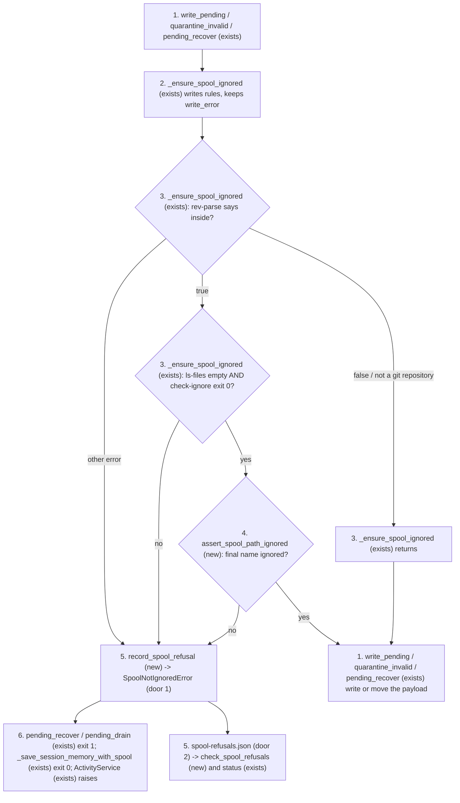

# F0.2 #202: the spool refuses to write when git could stage it

**Approved**: 2026-11-26 - Sammy (via Otto, 3bf07add-8153-469b-89ce-6409dace4213, Parker 0f272fcd), user: "Aprovo (Recommended)"; Q1: "Seguir com aviso (Recommended)" (on refusal the session/compact hooks exit 0 with one stderr line, and the refusal is recorded for doctor/status)

- What: plan r2, chain 20261126-axon-competitive, roadmap item F0.2 (issue sammyjdev/axon#202). Owner: Pietro. Status: r2 after Vera's critic review (FAIL, 6 findings) and Otto's Q1 mitigation request (99adb090), for her delta check, then Otto, then Sammy. Changed since r1: see Revision 2 delta at the end.
- SHA-256: in the result to Otto and in Pietro's work/20261126-axon-competitive/RESULT.md (a file cannot hold its own hash).
- Repo: `sammyjdev/axon` (covered on ClaudeBot `main`). Base: `master` at `f898c82d9746f28c309247416c98f771a201dbc2`. Proposed branch: `fix/202-spool-ignore-refuse`. Draft PR; merge is Sammy's.
- Complexity: medium - small diff (one function, four call sites), but a privacy path (payloads hold literal prompts and compact summaries) is never low, and the refusal deliberately drops a payload (a data-loss trade-off decided by the roadmap).
- Flags: security - user data: spooled payloads carry verbatim prompts and summaries that an ordinary `git add -A` can commit (#202). No database flag (no schema, query or migration). No infra flag.
- Builder: Dani (security flag).
- Reviewers: Vera (plan, critic gate); Rita (code); Cyrus only if Vera's or Rita's security reading is inconclusive or low-confidence (the flag alone does not call him; the roadmap lists Cyrus for F0.2, so Otto may call him at review).
- Tests: atdd - recorded decisions exist: issue #202 (expected behaviour, proposed fix and test shape), roadmap F0.2 "refuse to proceed if pending payloads could be staged" (approved with D1-D8), and the #184/#197/#198 spool tests already in `tests/cli/`.
- Authorization: Sammy via Parker 31e511a9, "Aprovo todas (Recommended)" (D1-D8, 2026-11-26); Otto's dispatch 448a7d26 (plan request 1). Sammy's approval of this plan is required before any build. Not approved: merge, release, any change outside this plan.
- Inputs read: `ROADMAP-axon.md` sha256 9d0c14ad8d3f1f71a1c6914ade9c5fe34af2da745e0c286f3400a7cc276a6300; `state.md` 29a9c81144e35144bb4abeb3ae6bcab432946b548a778d3795acecd2c9a2e6a2; `diagnosis.md` 3606fe8efed358d314941a90549009df45ddf764667666fa654c918acea13d25; issue #202 body read with read-only gh on 2026-11-26.

## Problem

`_ensure_spool_ignored` (`src/axon/store/pending.py:69-118`) writes the spool ignore rules into the data root's `.gitignore` and ends in `except OSError: pass` (`pending.py:117-118`). When that write fails (read-only directory, full disk, `.gitignore` that is a directory), the function returns normally and every caller writes or moves the payload anyway: `write_pending` (`pending.py:132`), `quarantine_invalid` (`pending.py:155`, reached from `drain_pending` at `pending.py:198` and `pending.py:211`) and `pending_recover` (`src/axon/cli/pb.py:1157-1188`, call at `pb.py:1182`). Even when the write succeeds, nothing checks that git really ignores the path: a payload file already tracked, or a later negation rule, still leaves it stageable.

Payloads carry literal user prompts and full compact summaries (`pb.py:691-697`; `tests/cli/test_spool_not_committable.py` docstring). Evidence from #202, reproduced on `master`: with `chmod a-w .axon`, `axon pending recover` prints `Recovered 1 file(s)` with exit 0, then `git add -A && git status --short` shows `A  .axon/pending/sess.json`. The guard exists but cannot report that it did not run. Who pays: any user whose data root sits inside a repo; the cost is a private prompt committed and possibly pushed, which cannot be recalled.

When this ships, AXON never leaves a spool payload where git could stage it: if it cannot prove the spool directory is ignored, it writes nothing, says so on stderr with the reason, and the interactive commands exit 1.

## Shape

Reuses the existing ignore-rule writer and the existing spool layout (`PendingPaths`); the new rules are a git-evidence check after the write, a check of each payload's final file name, and one refusal record outside the spool. The rules that change an outcome run in `axon.store.pending` (pure functions plus `git` subprocess calls), which `tests/cli/` and `tests/store/` already reach through `CliRunner` and direct calls.

1. a caller asks to spool -> `write_pending` (exists), `quarantine_invalid` (exists) and `pending_recover` (exists) call `_ensure_spool_ignored(paths)` before any payload I/O.
2. `_ensure_spool_ignored` (exists) - writes the missing rules as today; an `OSError` from `mkdir`, the read or the write is kept as `write_error = f"{type(exc).__name__}: {exc}"` (never dropped), and the `.gitignore.<hex>.tmp` file is unlinked if `os.replace` fails. A write error alone does not refuse: the git proof of step 3 decides. When the proof passes despite it, one stderr line is printed: `[axon] spool ignore rule not written (<write_error>); git already ignores <dir>`.
3. `_ensure_spool_ignored` (exists) - git evidence per spool dir, every call `subprocess.run([...], cwd=None, stdin=subprocess.DEVNULL, capture_output=True, text=True, timeout=10, shell=False)` with `-C <parent>` and the child named relative to `<parent>` (`child.name`), never the full relative path (`AXON_DATA_ROOT` defaults to the relative `.axon`, `data_root.py:18-30`):
   - `<parent>` must be an existing directory after step 2; else refuse with the kept `write_error`.
   - `git -C <parent> rev-parse --is-inside-work-tree`: exit 0 and stdout `true` -> inside; exit 0 and stdout `false` (inside `.git/` or a bare repo), or exit 128 with `not a git repository` in stderr (the rule of `core/repo_identity.py:11-17`) -> outside, nothing can be staged, return; any other result (exit 128 for a missing or unsearchable dir, `dubious ownership`, permission denied, a timeout) -> refuse.
   - inside: `git -C <parent> ls-files -- <child.name>` must print nothing, and `git -C <parent> check-ignore -q <child.name>/probe.json` must exit 0.
4. `assert_spool_path_ignored(path)` (new, in `axon.store.pending`) - the same `check-ignore` on the payload's real final name, called just before the payload is created or moved: `write_pending` (the `final` name), `quarantine_invalid` (`dest`), `pending_recover` (`target`); this catches a partial-name negation such as `!pending/sess-*.json` under `pending/*`.
5. any failed proof -> `record_spool_refusal` (new) updates the refusal record (door 2), best effort, then `SpoolNotIgnoredError` (door 1) is raised with the directory and the reason; `FileNotFoundError` from `git` gives the reason `git not found`, `TimeoutExpired` gives `git timed out after 10s`; the caller writes and moves nothing.
6. out: `pending recover` and `pending drain` (exist, `pb.py`) print the message to stderr and exit 1; the session/compact hook path `_save_session_memory_with_spool` (exists, `pb.py:672-711`) prints it to stderr and keeps exit 0; `ActivityService.ingest_events` (exists, `activity/service.py:39`) lets the error propagate (no file under `activity-pending/`); `axon doctor` `check_spool_refusals` (new) and `axon status` (exists, `__main__.py:283-310`) read the record.

**Changes underneath**

| Front | What changes |
| --- | --- |
| domain | `_ensure_spool_ignored` meant "try to write the rules"; now means "prove the spool is ignored or raise". Callers that branch on it: `write_pending`, `quarantine_invalid`, `pending_recover`, plus `spool_event` and `drain_pending` through them |
| stored data | nothing to migrate; payloads already on disk are untouched (a refused drain leaves them where they are) |
| readers | `tests/cli/test_spool_ignore_edges.py::test_ignore_file_write_oserror_is_swallowed_during_session_hook_spool` pins the old claim (payload still spooled when the ignore write fails); criterion 3 reverses it, so that test is replaced by criterion 3's test in the same commit. `tests/cli/test_hook_spool.py::test_a_failing_spool_write_prints_and_returns_without_raising` (hook exit 0) stays true and is kept (criterion 9) |
| readers | `axon doctor` `capture.pending_backlog` / `capture.warnings_log` read the same directories, unchanged; `run_all_checks` gains `capture.spool_refusals` and `axon status` gains a first line, both reading the refusal record (criteria 17, 18) |

Data: none - no database table or stored schema changes; only files under the data root.

## Surface

None - no HTTP route or consumed API changes. The CLI exit codes and output lines this changes are criteria 7-9, 14 and 16-18.

## Landing

| One-way door | Literal shape | Alternative rejected |
| --- | --- | --- |
| 1. Refusal contract callers and tests bind to (stable API: the storage ADR r2 relies on it for `git_event` and the session hooks, handled as "stderr + exit 0") | `class SpoolNotIgnoredError(RuntimeError)` in `axon.store.pending`, `__init__(self, directory: Path, reason: str)`, attributes `.directory` and `.reason`, `str(exc) == f"spool not ignored: {directory}: {reason}"`; raised only by `_ensure_spool_ignored` and `assert_spool_path_ignored` | returning a bool (issue's option A): every caller must remember to check it, which is the exact failure #202 describes; letting the raw `OSError` out: misses the tracked-file and negation cases, which raise no `OSError` |
| 2. Refusal record read by `axon doctor` and `axon status` | file `load_runtime_config().data_root / "spool-refusals.json"` (`AXON_ENGINE/data`, `runtime.py:57-58`, ignored by the engine checkout's `/data/*` rule, `.gitignore:27`); one JSON object `{"count": <int>, "last_at": "<ISO-8601 UTC>", "last_dir": "<absolute dir>", "last_reason": "<reason, at most 500 chars>"}`, rewritten atomically (temp file + `os.replace`); it holds paths and error text only, never payload content | a marker under the repo's data root (`.axon/`): unwritable in the very case it must report (read-only `.axon`); a line in `capture-warnings.jsonl`: same location, and doctor warns only at 10 entries per hour (`capture.py:21-22`) |

- Nothing else in this change is hard to reverse

## Criteria

### S1: no stageable payload is ever written (P1)

A payload lands only in a directory git provably ignores, or outside any git work tree.

**Acceptance Criteria**

1. WHEN `write_pending` runs with the data root inside a git work tree whose `.gitignore` write succeeds THEN the system SHALL write the payload and `git check-ignore -q <data_root>/pending/<file>` SHALL exit 0
   - Verify: existing `tests/cli/test_spool_not_committable.py::test_git_add_all_stages_nothing_under_pending_after_the_hook_spooled` stays green.
   - Red at f898c82d: none needed - this is today's passing behaviour, kept as a guard; the deliberate break is deleting the rule write, which turns it red.
2. IF writing the ignore rules raises `OSError` (test: `axon.store.pending.os.replace` monkeypatched to raise `OSError(30, "Read-only file system")`) AND git does not already ignore the spool dir THEN `write_pending` SHALL raise `SpoolNotIgnoredError` whose message contains `OSError: [Errno 30] Read-only file system`, `<data_root>/pending/` SHALL hold 0 `*.json` files, and no `.gitignore.*.tmp` file SHALL remain
   - Verify: new `tests/store/test_spool_refuses_unignored.py::test_write_pending_refuses_when_ignore_write_fails`.
   - Red at f898c82d: the OSError is swallowed, the payload is written (1 file), no exception is raised, and the temp file stays.
3. IF `.axon/.gitignore` is a directory (the real filesystem error the old test used) AND the spool is not otherwise ignored THEN the session hook SHALL leave 0 `*.json` files under `.axon/pending/` and `git add -A` SHALL stage nothing under `.axon/pending/`
   - Verify: new `tests/cli/test_spool_ignore_edges.py::test_ignore_file_write_oserror_refuses_the_session_hook_spool` (replaces the `..._is_swallowed_...` test in the same commit).
   - Red at f898c82d: 1 payload is written under `pending/`.
4. IF a file under `<data_root>/pending/` is already tracked by git (committed before the fix) THEN `write_pending` SHALL raise `SpoolNotIgnoredError` whose message contains `tracked` and SHALL write no new file, both with `AXON_DATA_ROOT` set to an absolute path and with it unset (default relative `.axon`, cwd the repo, `.axon/.gitignore` holding `/pending/`)
   - Verify: new `tests/store/test_spool_refuses_unignored.py::test_write_pending_refuses_when_a_spool_file_is_tracked` (parametrized over the two data-root forms).
   - Red at f898c82d: the rule is already present, the function returns, and a second file is written.
5. IF the spool dir is not ignored after the write (test: `.axon/.gitignore` already holds `pending/` and `pending-quarantine/` each followed by a negation `!pending/` and `!pending-quarantine/`; the writer sees the rules as present and adds nothing, and `git check-ignore` exits 1) THEN `quarantine_invalid` SHALL raise `SpoolNotIgnoredError` and the source file SHALL stay in `pending/` (not moved), with `AXON_DATA_ROOT` absolute and unset alike
   - Verify: new `tests/store/test_spool_refuses_unignored.py::test_quarantine_refuses_when_check_ignore_fails` (parametrized over the two data-root forms).
   - Red at f898c82d: the file is moved to `pending-quarantine/`.
6. WHEN `git rev-parse --is-inside-work-tree` run in the data root's parent exits 0 with stdout `false`, or exits 128 with `not a git repository` THEN `write_pending` SHALL write the payload as today (1 file) and raise nothing
   - Examples: a tmp dir outside any repo -> written; a data root under `.git/` (`AXON_DATA_ROOT=<repo>/.git/axon`) -> written.
   - Verify: existing `tests/store/test_pending.py::TestWritePending` (tmp dirs outside any repo) stays green, plus new `tests/store/test_spool_refuses_unignored.py::test_write_pending_outside_a_work_tree_writes` (parametrized over the examples).
   - Red at f898c82d: passes today (guard). Deliberate break: treating "not a work tree" as a failure turns it red.
12. IF `rev-parse` gives any other result (test: `<parent>` is a regular file so `mkdir` fails, exit 128 `cannot change to`; or `subprocess.run` raises `TimeoutExpired`) THEN `_ensure_spool_ignored` SHALL raise `SpoolNotIgnoredError` (fail closed) and no payload SHALL be written
    - Examples: `.axon` is a regular file inside a repo -> refused with the kept `write_error`; timeout -> reason `git timed out after 10s`.
    - Verify: new `tests/store/test_spool_refuses_unignored.py::test_unclassified_rev_parse_result_refuses` (parametrized).
    - Red at f898c82d: no git call; the `.axon`-is-a-file case raises a raw `FileExistsError`/`NotADirectoryError` instead of `SpoolNotIgnoredError`.
13. IF the spool dir is ignored but the payload's final name is not (test: `.axon/.gitignore` holds `pending/*` and `!pending/sess-*.json`, and `write_pending` is called with `commit_hash="sess"`) THEN `write_pending` SHALL raise `SpoolNotIgnoredError` and `git status --porcelain --untracked-files=all` SHALL list nothing under `.axon/pending/`
    - Verify: new `tests/store/test_spool_refuses_unignored.py::test_partial_name_negation_is_refused`.
    - Red at f898c82d: `.axon/pending/sess-<ts>-<hex>.json` is written and shows as untracked.
14. WHEN the ignore-rule write fails but git already ignores the spool dir (test: root `.gitignore` holds `.axon/`, `os.replace` monkeypatched to raise `OSError`) THEN `write_pending` SHALL write the payload (1 file) and print one stderr line starting `[axon] spool ignore rule not written (OSError:`
    - Verify: new `tests/store/test_spool_refuses_unignored.py::test_write_error_with_proven_ignore_writes_and_reports`.
    - Red at f898c82d: the payload is written but nothing is printed (the error is swallowed).

### S2: the refusal is loud (P1)

**Acceptance Criteria**

7. IF `axon pending recover` runs while the spool cannot be proven ignored (`os.replace` monkeypatched to raise `OSError` in a fresh `git init` repo) THEN the command SHALL exit 1, print a stderr line starting `spool not ignored:` that contains `OSError`, and leave every file in `pending-quarantine/` unmoved
   - Verify: new `tests/cli/test_spool_recover_ignore.py::test_recover_refuses_and_exits_1_when_ignore_cannot_be_proven`.
   - Red at f898c82d: exit 0, `Recovered 1 file(s)`, file moved (the #202 reproduction).
8. IF `axon pending drain` would quarantine a malformed payload while the spool cannot be proven ignored THEN the command SHALL exit 1 with a stderr line starting `spool not ignored:` and the malformed file SHALL stay in `pending/`
   - Verify: new `tests/cli/test_spool_drain_refuses.py::test_drain_exits_1_when_quarantine_is_refused` (the store sink is stubbed; no Postgres).
   - Red at f898c82d: exit 0 and the file is moved to `pending-quarantine/`.
9. WHILE the store is down, WHEN `axon session-hook` or `axon compact-hook` must spool and the spool cannot be proven ignored THEN each hook SHALL exit 0, print a stderr line containing `spool not ignored:`, and write 0 payload files
   - Verify: new `tests/cli/test_hook_spool.py::test_hook_reports_refused_spool_and_exits_0`, parametrized over `session-hook` and `compact-hook` (each with its own payload and transcript); existing `test_a_failing_spool_write_prints_and_returns_without_raising` stays green.
   - Red at f898c82d: exit 0 but 1 payload written and no `spool not ignored:` line, for each hook.
10. IF `ActivityService.ingest_events` must spool while the activity spool cannot be proven ignored THEN it SHALL raise `SpoolNotIgnoredError` and `<data_root>/activity-pending/` SHALL hold 0 `*.json` files
    - Verify: new `tests/activity/test_activity_spool_refuses.py::test_ingest_refuses_unignored_spool` (repository stubbed; no Postgres).
    - Red at f898c82d: the event is written to `activity-pending/`.
11. IF the `git` executable cannot be run (test: `PATH` without git, or `subprocess.run` raising `FileNotFoundError`) THEN `_ensure_spool_ignored` SHALL raise `SpoolNotIgnoredError` whose message contains `git not found` (fail closed)
    - Verify: new `tests/store/test_spool_refuses_unignored.py::test_refuses_when_git_is_missing`.
    - Red at f898c82d: no git call exists; the payload is written.

### S3: a dropped payload is visible (P1, mitigation for Q1)

**Acceptance Criteria**

15. WHEN `SpoolNotIgnoredError` is raised THEN the system SHALL first update `load_runtime_config().data_root / "spool-refusals.json"` to the door 2 shape: `count` increased by 1 (1 when the file was absent), `last_at` the UTC time of the refusal, `last_dir` the absolute refused dir, `last_reason` the exception's reason; two refusals in a row SHALL give `count` 2
    - Verify: new `tests/store/test_spool_refusal_record.py::test_each_refusal_updates_the_record` (clock pinned; asserts the JSON object exactly).
    - Red at f898c82d: no record file exists.
16. IF the refusal record cannot be written (test: `spool-refusals.json` is a directory) THEN the refusal SHALL still raise `SpoolNotIgnoredError`, the hooks SHALL still exit 0, and one stderr line SHALL start `[axon] could not record spool refusal:`
    - Verify: new `test_spool_refusal_record.py::test_unwritable_record_does_not_change_the_refusal`.
    - Red at f898c82d: no record exists to fail.
17. WHEN `axon doctor` runs and the record holds `count` 2 THEN its capture checks SHALL print the line produced by `f"[warn] {'capture.spool_refusals':<32} 2 spool refusal(s); last <last_at>: <last_reason>"` followed by the suggestion line `        → Fix the git ignore rule for the spool, then delete <record path>`; with no record file it SHALL print `[ ok ] capture.spool_refusals` padded the same way with the detail `no spool refusals`
    - Verify: new `tests/doctor/test_check_spool_refusals.py::test_doctor_warns_on_recorded_refusals` and `::test_doctor_ok_without_record` (through `human_format(run_all_checks())`, `doctor/formatters/human.py:14-23`).
    - Red at f898c82d: no `capture.spool_refusals` check exists.
18. WHEN `axon status` runs THEN its first output line SHALL be `spool refusals: <count> (last <last_at>: <last_reason>)`, or `spool refusals: 0` with no record file, printed before the decision query so it appears when the store is down
    - Verify: new `tests/cli/test_status_spool_refusals.py::test_status_first_line_reports_refusals` (record present; store stubbed to raise) and `::test_status_reports_zero_without_record`.
    - Red at f898c82d: `status` prints `repo:` first and nothing about refusals (`__main__.py:303-310`).

## Build steps

Each step names how it is verified; the builder writes `checks.md` from the criteria.

1. Write the new and replaced tests for criteria 2-18 first; verify: `python3 -m pytest tests/store/test_spool_refuses_unignored.py tests/store/test_spool_refusal_record.py tests/cli/test_spool_ignore_edges.py tests/cli/test_spool_recover_ignore.py tests/cli/test_spool_drain_refuses.py tests/cli/test_hook_spool.py tests/cli/test_status_spool_refusals.py tests/activity/test_activity_spool_refuses.py tests/doctor/test_check_spool_refusals.py -q` fails at f898c82d on criteria 2-5 and 7-18 (record the output in checks.md); these files need no Docker.
2. Add `SpoolNotIgnoredError` (door 1), the git-evidence check with the classification of Shape step 3, the temp-file cleanup and `assert_spool_path_ignored`; verify: criteria 2, 4, 5, 6, 11, 12, 13, 14 pass.
3. Add `record_spool_refusal` (door 2), `check_spool_refusals` in `run_all_checks` and the `status` first line; verify: criteria 15-18 pass.
4. Make `pending_recover` and `pending_drain` catch `SpoolNotIgnoredError`, print it to stderr and `raise typer.Exit(1)`; verify: criteria 7, 8 pass.
5. Confirm both hook paths keep exit 0 with the message (`_save_session_memory_with_spool` already prints the exception; `compact-hook` wraps it at `pb.py:961`); verify: criteria 3, 9 pass.
6. Confirm the activity path propagates; verify: criterion 10 passes.
7. Run the gate; verify: `ruff check src && python3 -m compileall -q src && python3 -m pytest -q` exits 0 with `.[dev,http]` installed and Docker running (CI full-suite job green on the PR head).

## Dependencies

- Other F0 items: none. F0.1, F0.3 and F0.5 touch other files; F0.4 (privacy closed by default, D1) is NOT a dependency: D1 governs identity at capture, not the spool ignore guard, and this plan does not read identity config.
- D-decisions: none required; D1-D8 approval covers the roadmap order (F0.2 first).
- Later consumer: the storage ADR r2 (F1.1) restores the spool for `git_event` and the session hooks and handles `SpoolNotIgnoredError` as "stderr + exit 0"; door 1's name, module, signature and message prefix stay stable for it.
- Tools: `git` on PATH at runtime (already required by the hooks); CI image ubuntu-latest has git. Python >=3.11 (`pyproject.toml`). The spool test files of build step 1 run with `.[dev]` and no Docker; the full gate needs `.[dev,http]` (`tests/http` imports FastAPI; `ci.yml:86`) and a Docker daemon for the testcontainers Postgres tests. No new dependency.
- Test isolation: the suite's autouse `_isolate_global_git_config` (`tests/conftest.py:224`) gives temp repos no global excludes, which criteria 2-5 rely on; `_isolate_axon_engine` (`tests/conftest.py:255`) gives each test its own `AXON_ENGINE`, so the refusal record of criteria 15-18 never touches the operator's file.

## Out of scope

| Excluded | Why |
| --- | --- |
| Writing the refused payload somewhere outside the repo (a fallback spool) | a new capability; the issue and roadmap choose "do not write, fail loudly"; candidate card if Sammy wants it |
| Clearing the refusal record automatically (for example on the next successful spool) | a cleared record would hide a refusal nobody saw; the doctor suggestion says to delete the file after fixing the rule |
| Finding 1 of #202 (dotfile name breaks recover's `rsplit`) | the issue itself marks it unrelated and not a defect of this guard |
| Changing the ignore rule set or where `.gitignore` is written | #184/#197 behaviour, already pinned by `test_spool_ignore_boundaries.py` |
| F0.4 identity gating | separate plan after D1 |

## Assumptions

| Assumption | Chosen default | Rationale | Confirmed? |
| --- | --- | --- | --- |
| Session/compact hooks exit code on refusal | exit 0 with the stderr message (criterion 9), plus the refusal record shown by `axon doctor` and `axon status` (criteria 15-18) | hook contract "a hook must never interrupt the agent" pinned by `test_hook_spool.py:313` (AC7 of #184) and `tests/cli/test_agent_hooks.py:50-52`; a non-zero Stop hook can block the agent; Vera agrees (critic r1, Q1); open question Q1 for Sammy | n |
| Data root outside any git work tree | write as today | nothing there can be staged by git; matches `tests/store/test_pending.py`; only `false` or `not a git repository` count as outside (criteria 6, 12) | n - criteria 6 and 12 test both sides |
| `git` missing at runtime | refuse (fail closed) | a guard that cannot run must not report success (#202's own principle) | n - criterion 11 tests it |
| `git check-ignore` reports a tracked path as not ignored | rely on it, plus `git ls-files` for tracked files | git docs: tracked files are not subject to exclude rules; criterion 4 tests the tracked case directly, so the build does not depend on this reading | n - criterion 4 |
| A refused payload is lost | accepted, and made visible (criteria 15-18) | #202: "A payload that never lands is recoverable; one staged into a commit is not". What is lost: the `session_memory` digest and the compact summary of that save; what remains: the raw harness transcript, which `axon activity backfill` imports into `activity_sessions` / `activity_events` only (`activity/importer.py:126-155`), not into `session_memory` | n - Q1 asks Sammy to confirm |

**Open questions:**
- Q1 (open, does not block build): should the session/compact hooks exit non-zero when the spool is refused? Recommendation (Pietro, Vera agrees): no, exit 0 with the stderr line (criterion 9), because a failing Stop hook can block the agent; the interactive commands exit 1. Mitigation for the silent drop: every refusal is counted in `spool-refusals.json` outside the spool, and `axon doctor` warns and `axon status` reports it (criteria 15-18). Sammy confirms the trade-off: a digest dropped during a database outage with an unprovable ignore rule, visible afterwards, instead of a hook that can interrupt the agent.

## Differences from the source

None - the product matches the source (issue #202 and roadmap F0.2); the one choice the source leaves open, the hooks' exit code, is Q1.

## Gate

Command: `ruff check src && python3 -m compileall -q src && python3 -m pytest -q`

## Sources

- Issue sammyjdev/axon#202 - binding - expected behaviour, call sites, test shape.
- `ROADMAP-axon.md` F0.2 (sha256 9d0c14ad...) - binding (approved with D1-D8) - "refuse to proceed if pending payloads could be staged".
- Code at f898c82d: `src/axon/store/pending.py:69-169`, `src/axon/cli/pb.py:672-711`, `pb.py:1109-1188`, `src/axon/activity/spool.py:29-44`, `src/axon/activity/service.py:39-104`; tests `tests/cli/test_spool_*.py`, `tests/cli/test_hook_spool.py`, `tests/store/test_pending.py`.
- Gate: CI `.github/workflows/ci.yml` (`ruff check src`, `python3 -m pytest -q`); `CLAUDE.md` lines 139-140.

## Revision 2 delta

Source: Vera's critic review `critic-vera.md` (sha256 c58179e3bc9f8868ec9790495221d852ac000341d6316027ce4f382a99b81a5d), verdict FAIL (2 high, 2 medium, 2 low), and Otto's dispatch 99adb090 (Q1 mitigation, stable refusal API). r1 is kept byte-identical as `plan.r1-6d47014f.md`; `rev1-to-rev2.diff` is the full delta. Each finding was confirmed against the code at f898c82d before the fix.

Changed: the What line, Shape (intro, steps, drawing), two rows of Changes underneath, Surface, Landing (door 1 with signature and its ADR consumer, new door 2), Criteria (2, 4, 5, 6, 9 amended; 12-18 added; new slice S3), Build steps, Dependencies, one Out of scope row, Assumptions and Q1, Gate. Unchanged: the rest of the header, Problem, criteria 1, 3, 7, 8, 10, 11, Differences from the source, Sources.

Meaning changed: yes. Criteria 2 and 9 are stricter (exact error text and temp-file cleanup; both hooks tested separately); criteria 4 and 5 add the default relative data root; criterion 6 narrows "outside a work tree" to two exact `rev-parse` results; criteria 12-18 are new. Criteria 1, 3, 7, 8, 10 and 11 keep their r1 meaning. Door 1 keeps its name, module and message prefix; r2 only adds the constructor signature and attributes.

| # | Finding (Vera) | Confirmed at f898c82d | Change in r2 | Criteria |
| --- | --- | --- | --- | --- |
| 1 | HIGH: relative `AXON_DATA_ROOT=.axon` double-prefixes `-C <parent>` (tracked file missed, valid rule refused) | `data_root.py:18-30` returns `Path(".axon")`; `pending.py:50-59`, `activity/spool.py:17-26` build children from it | Shape step 3 names the child relative to `<parent>` (`child.name`); both data-root forms tested | 4, 5 |
| 2 | HIGH: `rev-parse` classification fails open on missing or unsearchable parents and misreads `.git/` / bare repos | `pending.py:78` `mkdir` can fail before the check; `core/repo_identity.py:11-17` documents `not a git repository` as the only "not a repo" signal | inside only on exit 0 + `true`; outside only on exit 0 + `false` or exit 128 + `not a git repository`; a missing parent or any other result refuses | 6, 12 |
| 3 | MEDIUM: precedence of the write error, message text, temp cleanup, subprocess safety | `pending.py:114-118` (temp file, `os.replace`, `except OSError: pass`); `mcp/server.py:686-690` uses `stdin=DEVNULL`; `capture_path.py:28` `_GIT_TIMEOUT_S = 10` | write error kept as `TypeName: message`; the git proof decides, with a stderr line when it passes anyway; temp file unlinked; `git not found` / timeout reasons; `stdin=DEVNULL`, `timeout=10`, `shell=False` | 2, 11, 12, 14 |
| 4 | MEDIUM: Q1 rationale overclaims transcript recovery; criterion 9 merges two hooks; `criterion 7` typo | `activity/importer.py:126-155` fills activity tables only; `compact-hook` has its own wrapper (`pb.py:961`); r1 `plan.md:52` | rationale corrected (digest and compact summary are lost); criterion 9 parametrized over both hooks; typo fixed (criterion 9); Q1 mitigation added (record + doctor + status) | 9, 15-18 |
| 5 | LOW: `check-ignore` on `probe.json` misses a partial-name negation under `pending/*` | `pending.py:102-105` accepts `pending/*` as present; quarantine names end in `.<ts_ns>` (`pending.py:158`) | `assert_spool_path_ignored` checks the real final name before each create or move (`final`, `dest`, `target`) | 13 |
| 6 | LOW: Dependencies and Gate understate the full suite | `ci.yml:43` compileall, `ci.yml:86` `.[dev,http]`; Postgres tests need Docker | Gate adds `python3 -m compileall -q src`; Dependencies name `.[dev,http]` and Docker, and say the spool test files run without Docker | gate |
| Q1 | Otto: make the dropped digest visible without failing the hook | no refusal is recorded anywhere today | `spool-refusals.json` outside the spool (door 2), `capture.spool_refusals` in `axon doctor`, first line of `axon status`; best effort | 15-18 |
