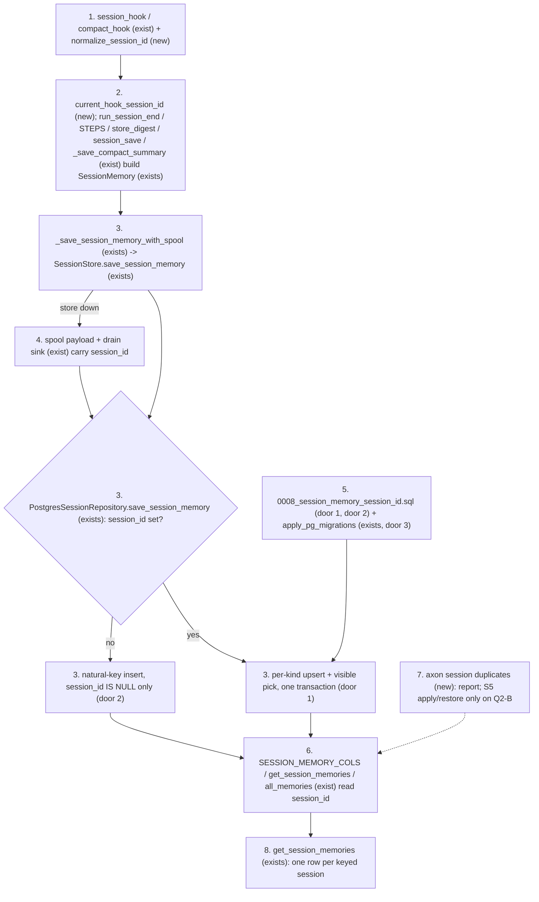
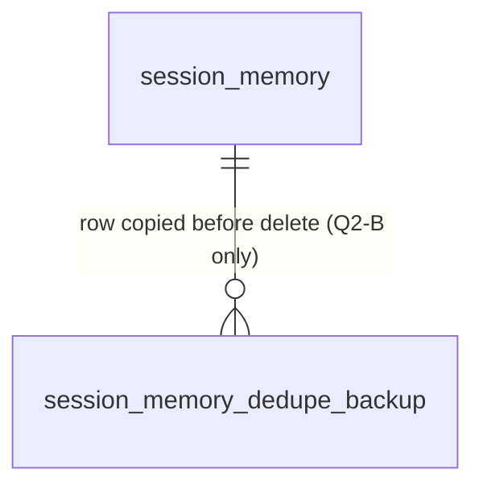

# F0.3 #187: one session_memory row per session_id, legacy duplicates reported, never guessed

**Approved**: 2026-11-27 - Sammy (via Otto, a8cd199f-1121-4029-a162-a1d85f551561, Parker 7998e67e), user: "Aprovo (Recommended)"; Q1: "A: uma linha, protegida (Recommended)"; Q2: "A: só listar (Recommended)"

- What: plan r3, chain 20261126-axon-competitive, roadmap item F0.3 (issue sammyjdev/axon#187). Owner: Pietro. Status: r3 after Vera's r2 delta (PASS, 1 low note) and Dale's r2 delta (FAIL, D1-D3); for Dale's delta check of D1-D3, then Otto, then Sammy. **Q1 and Q2 block the build: Sammy decides them before approval.** Changed since r2: see Revision 3 delta at the end (r2's delta kept above it).
- SHA-256: in the result to Otto and in Pietro's work/20261126-axon-competitive/RESULT.md.
- Repo: `sammyjdev/axon` (covered on ClaudeBot `main`). Base: `master` at `f898c82d9746f28c309247416c98f771a201dbc2`. Proposed branch: `fix/187-session-memory-upsert`. Draft PR; merge is Sammy's.
- Complexity: medium - a schema migration with serialized startup, a guarded upsert, plumbing of one field through the hook, spool and drain paths, and a read-only duplicates report; a backed-up delete only if Sammy chooses Q2-B (data-loss path, so never low).
- Flags: database - new column, partial unique indexes, a guarded upsert, a migration-runner lock, and (Q2-B only) a row-deleting cleanup on user data. Not security (no auth, secrets or new external input; the `session_id` comes from the harness payload AXON already parses and is normalized). Not infra.
- Builder: Dani (database flag).
- Reviewers: Vera (plan, critic gate); **Dale** (database: plan-stage review before Sammy approves, and the migration, the upsert and the duplicates command at code review); Rita (code).
- Tests: atdd - recorded decisions exist: issue #187 expected behaviour ("One row per session, upserted on the `session_id` from the hook payload") and its 2026-11 comment, roadmap F0.3 (approved with D1-D8), and the existing `tests/store/test_pg_session_repository.py`, `tests/store/test_pg_migrations.py`, `tests/cli/test_hook_spool.py`. The snapshot guard (criteria 15-18) and the duplicates report (criteria 8-14) are new and specified here.
- Authorization: Sammy via Parker 31e511a9, "Aprovo todas (Recommended)" (D1-D8, 2026-11-26); Otto's dispatch 448a7d26 (plan request 3). Sammy's approval of this plan is required before any build. Not approved: running `axon session duplicates --apply` or `--restore` on Sammy's database (Q2-B only) (a production data change that needs Sammy's own go-ahead, skill rule 8), merge, release.
- Inputs read: `ROADMAP-axon.md` sha256 9d0c14ad8d3f1f71a1c6914ade9c5fe34af2da745e0c286f3400a7cc276a6300; `state.md` 29a9c81144e35144bb4abeb3ae6bcab432946b548a778d3795acecd2c9a2e6a2; `diagnosis.md` 3606fe8efed358d314941a90549009df45ddf764667666fa654c918acea13d25; issue #187 body and comment read with read-only gh on 2026-11-26.

## Problem

`session_memory` has no `session_id` column (`src/axon/store/migrations/pg/0001_session_baseline.sql:6-12`). `PostgresSessionRepository.save_session_memory` (`src/axon/store/pg_session_repository.py:42-58`) inserts with `ON CONFLICT (project, md5(summary), raw_turns, created_at) DO NOTHING` (unique index `uq_session_memory_natural`, `0003_hash_natural_key_indexes.sql:7-9`); `created_at` differs on every save, so the key never matches and every save of the same session adds a row. The hook payload's `session_id` is never read: `session_hook` (`src/axon/cli/pb.py:965-994`) passes only `transcript_path` and `cwd` to `run_session_end` (`src/axon/hooks/session_end.py:15-18,64-69`), `session_save` (`pb.py:713-767`) builds `SessionMemory(project, summary, raw_turns)` (`src/axon/store/session_store.py:37-42`), and `compact_hook` / `_save_compact_summary` (`pb.py:923-962`) do the same.

Evidence from #187: 1062 rows for 235 sessions, up to 158 rows for one session; `get_session_memories(limit=3)` (`pg_session_repository.py:60-68`, read by the MCP tool at `src/axon/mcp/server.py:103`) returns near-identical snapshots of one session instead of the last three sessions. The per-turn cost is gone since dec-138 (issue comment), but a session saved by both SessionEnd and PostCompact still writes two rows. Who pays: every agent that recalls recent sessions, which gets less distinct history in its context.

When this ships, each harness session with a `session_id` has exactly one `session_memory` row holding its newest snapshot, recall returns distinct sessions, and the duplicates already stored are reported without guessing which session they belong to (removed only if Sammy chooses Q2-B, with a backup that restores them).

## Shape

Reuses the versioned migration runner (`apply_pg_migrations`, `src/axon/store/pg_migrations.py:27-54`), the existing save path and spool; the rules (session-id normalization, upsert key, the snapshot guard, the NULL-only natural key, the duplicates report) run in SQL issued by `PostgresSessionRepository` and in two small pure functions, reached by the testcontainers Postgres tests and `CliRunner` tests.

1. hook payload `{session_id, transcript_path, cwd}` -> `session_hook` / `compact_hook` (exist) pass `payload.get("session_id")` through `normalize_session_id` (new): a `str` whose `.strip()` is 1-200 characters -> the stripped value; anything else (absent, `""`, whitespace, a number, an object, longer than 200) -> `None`.
2. `session_hook` / `compact_hook` (exist) set `current_hook_session_id` (new, a `contextvars.ContextVar[str | None]`, default `None`) for the duration of the hook; `run_session_end` (exists), `STEPS` (exists, still 2-argument), `store_digest` (exists, unchanged call `session_save(cwd=..., transcript=...)`) and `_save_compact_summary` (exists, unchanged keywords `project=, summary=`) keep their signatures; `session_save` (exists) and `_save_compact_summary` read the context value and build `SessionMemory` (exists) with the new optional `session_id` field. No CLI option is added: manual `axon session save` always saves with `session_id = None`.
3. `_save_session_memory_with_spool` (exists) -> `SessionStore.save_session_memory` (exists) -> `PostgresSessionRepository.save_session_memory` (exists): with a `session_id`, one transaction of two statements (door 1): (a) the upsert keeps, per kind, the greatest snapshot by its own data (compact group: `compact_summary`, `compact_created_at`; digest group: `digest_summary`, `digest_raw_turns`, `digest_created_at`); (b) the visible `summary`, `raw_turns`, `created_at` are recomputed from the two groups by the pick rule of S3. The result depends only on the set of snapshots received, never on their arrival order; the id comes from `RETURNING`, or from a lookup when the project check skips the update. Without a `session_id`: the natural-key insert of door 2, scoped to `session_id IS NULL`.
4. on store failure the spool payload (exists, `pb.py:691-697`) gains `"session_id"` only when it is not `None`; `created_at` is fixed when `SessionMemory` is built and travels in the payload, so a retry keeps the capture time; the drain sink (exists, `session_store.py:258-266`) passes `normalize_session_id(payload.get("session_id"))` back to step 3 (a malformed value becomes `None`, it is not quarantined).
5. migration `0008_session_memory_session_id.sql` (door 1, door 2) adds the column, the five nullable per-kind snapshot columns, the partial unique index, and rebuilds the natural index as partial; the runner (exists, changed, door 3) serializes concurrent initializers and bounds every lock wait (the timeout is set before the first lock).
6. reads: `SESSION_MEMORY_COLS` / `row_to_session_memory` (exist, `_session_columns.py:18-19,35-43`) carry `session_id`; `get_session_memories` and `all_memories` (exist, `pg_session_repository.py:60-68,152-158`) select it and order by `created_at DESC, id DESC` (`all_memories`: `created_at, id`).
7. `axon session duplicates` (new, report only) - lists groups of `session_id IS NULL` rows that share `project`, `raw_turns` and the exact `summary` text; it changes no row. Only if Sammy chooses Q2-B, `--apply` and `--restore` (S5) delete and restore byte-identical duplicates with a full backup.
8. out: `get_session_memories` returns one row per keyed session; legacy rows are untouched and fall out of the top 3 once newer keyed sessions exist.

**Changes underneath**

| Front | What changes |
| --- | --- |
| domain | a `session_memory` row meant "one save"; with a `session_id` it now means "the snapshot of that session picked by S3's rule from the latest compact summary and the latest digest", both kept in the row's per-kind columns (door 1). `get_session_memories` callers (MCP `get_session_memory`, `server.py:94-103`) read it with the same output text |
| domain | `uq_session_memory_natural` meant "dedup any row by content"; now it applies to `session_id IS NULL` rows only (door 2), so two sessions with identical content tuples no longer collide |
| stored data | new nullable column, no backfill; no existing row is changed or deleted by the migration or the hooks; legacy duplicates are reported, and deleted only under Q2-B with a backup |
| readers | `session_end.STEPS` monkeypatched with 2-argument callables (`tests/hooks/test_session_end.py:40-47,94,129`), `fake_save(*, cwd, transcript)` (`tests/cli/test_agent_hooks.py:35-47`), `fake_store(*, project, summary)` (`test_agent_hooks.py:91`), and the exact `{"project", "summary"}` dicts recorded from `_save_compact_summary` (`tests/cli/test_session_memory_repo_key.py:108,206`, `tests/cli/test_session_memory_repo_key_gaps.py:76,114,129,147`) all stay valid unchanged, because the session id travels in a context variable, not in these signatures (criterion 25) |
| readers | `SessionStore.drain_pending` sink (`session_store.py:258`) passes the normalized `session_id` (criterion 7); payloads spooled before the change have no key and keep the natural-key insert |
| readers | `tests/store/test_pg_session_repository.py::test_large_summary_and_note_roundtrip_and_dedup` pins the natural-key dedup; it stays true for rows without `session_id` (criterion 4) |
| readers | `tests/conftest.py:26-31` `_AXON_TABLES` gains `session_memory_dedupe_backup` (truncation is safe if the table is absent, `conftest.py:218`) |
| readers | F0.2 (`f0-2-spool-ignore`) changes `_save_session_memory_with_spool`'s spool refusal (`pb.py:672-711`) and `pending.py`; F0.3 adds one optional payload key there and rebases on F0.2 if it merges first |

New: column `session_memory.session_id` (nullable), the per-kind columns `compact_summary`, `compact_created_at`, `digest_summary`, `digest_raw_turns`, `digest_created_at` (all nullable, NULL on rows without a session id), partial unique index on `session_id`, the natural index rebuilt as partial; table `session_memory_dedupe_backup` only under Q2-B. No relation to `activity_sessions` (r1's time-window backfill is removed). One-way constraints: `session_id` unique where not null (door 1); content dedup only where `session_id IS NULL` (door 2).

## Surface

None - no HTTP route or consumed API changes. The new CLI command `axon session duplicates` and its exit codes are criteria 8 and 11 (and 12-14 under Q2-B); the MCP tool output text is unchanged (criterion 24).

## Landing

| One-way door | Literal shape | Alternative rejected |
| --- | --- | --- |
| 1. Upsert key and replay-stable snapshot pick (migration `src/axon/store/migrations/pg/0008_session_memory_session_id.sql`) | `ALTER TABLE session_memory ADD COLUMN IF NOT EXISTS session_id text, ADD COLUMN IF NOT EXISTS compact_summary text, ADD COLUMN IF NOT EXISTS compact_created_at timestamptz, ADD COLUMN IF NOT EXISTS digest_summary text, ADD COLUMN IF NOT EXISTS digest_raw_turns integer, ADD COLUMN IF NOT EXISTS digest_created_at timestamptz;` and `CREATE UNIQUE INDEX IF NOT EXISTS uq_session_memory_session_id ON session_memory (session_id) WHERE session_id IS NOT NULL;`. Save, one transaction: (a) `INSERT ... ON CONFLICT (session_id) WHERE session_id IS NOT NULL DO UPDATE SET <group columns> WHERE session_memory.project = EXCLUDED.project RETURNING id`, where the incoming snapshot replaces its kind's group only when its kind key is greater (compact key `(created_at, octet_length(summary), summary COLLATE "C")`; digest key `(created_at, octet_length(summary), summary COLLATE "C", raw_turns)`; an empty group always takes it); (b) `UPDATE session_memory SET summary, raw_turns, created_at = the picked group WHERE session_id = $5 AND project = $1` (pick rule in S3). No row returned by (a) (other project) -> `SELECT id FROM session_memory WHERE session_id = $5`. `project` is never updated. SQLite port (F1.1, ADR r4 Decision 8): the same two statements inside `BEGIN IMMEDIATE`, `ON CONFLICT ... WHERE ... DO UPDATE ... WHERE` (SQLite >= 3.24; `RETURNING` >= 3.35), `length(CAST(summary AS BLOB))` for `octet_length`, the default `BINARY` collation for `COLLATE "C"`, row-value comparison (SQLite >= 3.15); partial indexes exist since SQLite 3.8.0 | a single-statement guard on the visible row only (r2): its result depended on arrival order when a spooled compact summary was replayed after a thinner digest (Dale D2); `NOT NULL` column or a full unique constraint: impossible over existing rows with no key; key `(session_id, kind)` with two rows: Q1 option B; key `(project, session_id)`: a renamed project would duplicate a session; newest-wins without the guard: Q1 option C |
| 2. Natural key only for rows without a session id | `DROP INDEX IF EXISTS uq_session_memory_natural; CREATE UNIQUE INDEX uq_session_memory_natural ON session_memory (project, md5(summary), raw_turns, created_at) WHERE session_id IS NULL;` NULL path: `INSERT ... ON CONFLICT (project, md5(summary), raw_turns, created_at) WHERE session_id IS NULL DO NOTHING RETURNING id`, then the existing lookup with `AND session_id IS NULL`. SQLite port: `summary_digest` column instead of `md5(summary)`, on both backends at F1.1 (ADR r4 Decision 9, line 73), same partial predicate | keeping the full natural index: two different sessions with the same content tuple would conflict on it, and `ON CONFLICT (session_id)` does not handle that conflict (Dale 5) |
| 3. Serialized migration startup with bounded waits | `CREATE TABLE IF NOT EXISTS schema_version` runs in its own transaction that starts with `SET LOCAL lock_timeout = '5s'`; each pending file runs in a transaction whose first statement is `SET LOCAL lock_timeout = '5s'`, then `SELECT pg_advisory_xact_lock(7101870187)`, then a re-read of `schema_version` (skip the file if another process recorded it), then the DDL. `lock_timeout` bounds each lock acquisition, the advisory one included; a wait longer than 5 s raises `asyncpg.exceptions.LockNotAvailableError` (SQLSTATE 55P03), the transaction rolls back, nothing is recorded, and the save path spools as today. Worst case for one pending file: 5 s on the advisory lock plus 5 s on the `session_memory` lock (0008 touches one table; its later statements reuse the lock already held), so at most 10 s of waiting plus DDL time; no extra overall deadline. SQLite port: the migration runs inside `BEGIN IMMEDIATE` with `busy_timeout` (ADR r4 Decision 8) | the r2 order (advisory lock before the timeout): the advisory wait was unbounded (Dale D1); `pg_try_advisory_xact_lock` with a retry loop: more code for the same bound; `CREATE INDEX CONCURRENTLY`: cannot run inside the runner's transaction block |

- Nothing else in this change is hard to reverse. Rollback leaves the additive column and indexes in place unless a later migration is approved.

## Criteria

### S1: one row per session from now on (P1)

**Acceptance Criteria**

1. WHEN `save_session_memory` is called twice with the same `session_id` `"s-1"` and the same project (created_at T1 then T2 > T1, both digests, different summaries) THEN the system SHALL hold exactly 1 row with `session_id = 's-1'`, carrying the T2 summary, and both calls SHALL return the same id
   - Verify: new `tests/store/test_pg_session_memory_upsert.py::test_same_session_id_upserts_one_row`.
   - Red at f898c82d: the column does not exist (the test's insert fails), and by the natural key the two saves would be 2 rows.
2. IF a digest for `"s-1"` arrives with created_at older than the stored digest (a late spool drain) THEN the system SHALL leave the row byte-identical and return the existing id
   - Verify: new `test_pg_session_memory_upsert.py::test_older_snapshot_does_not_overwrite_and_returns_the_id`.
   - Red at f898c82d: no key; a second row is inserted.
3. WHEN migration `0008_session_memory_session_id` is applied to a database holding rows with no `session_id` THEN the system SHALL keep every existing row with identical column values (checksum of criterion 9), the five per-kind columns SHALL exist and be NULL on every existing row, `pg_indexes` SHALL show `uq_session_memory_session_id` with `WHERE (session_id IS NOT NULL)` and `uq_session_memory_natural` with `WHERE (session_id IS NULL)`, and a second runner pass SHALL apply nothing (`schema_version` gains exactly 1 row)
   - Verify: new `tests/store/test_pg_migrations.py::test_0008_adds_session_id_without_touching_rows`.
   - Red at f898c82d: the file does not exist; `schema_version` has no `0008_...` row.
4. WHEN `save_session_memory` is called with `session_id = None` THEN the system SHALL insert by the natural key as today (2 different saves -> 2 rows; an identical save -> the same id)
   - Verify: existing `test_pg_session_repository.py::test_large_summary_and_note_roundtrip_and_dedup` stays green, plus new `test_pg_session_memory_upsert.py::test_rows_without_session_id_keep_natural_key`.
   - Red at f898c82d: passes today (guard). Deliberate break: upserting `None` on one key collapses the two rows and turns it red.
5. WHEN `axon session-hook` receives `{"session_id": "abc", "transcript_path": <2-turn transcript>, "cwd": <git repo>}` and is run twice THEN the stored rows for that project SHALL number 1 with `session_id = 'abc'`
   - Verify: new `tests/store/test_pg_session_hooks_e2e.py::test_session_hook_twice_keeps_one_row` (real Postgres) and `tests/cli/test_session_hook_session_id.py::test_hook_passes_session_id_to_the_row` (store stubbed to record the `SessionMemory`).
   - Red at f898c82d: `SessionMemory` has no `session_id`; 2 rows.
6. WHEN `axon compact-hook` receives a payload with `session_id` `"abc"` THEN the saved `SessionMemory` SHALL carry `session_id = 'abc'`
   - Verify: new `test_session_hook_session_id.py::test_compact_hook_passes_session_id`.
   - Red at f898c82d: the field does not exist.
19. IF a save arrives for a stored `session_id` with a different `project` THEN the system SHALL leave the stored row unchanged (project, summary, created_at) and return its id
    - Verify: new `test_pg_session_memory_upsert.py::test_other_project_does_not_take_over_a_session`.
    - Red at f898c82d: no key; a second row is inserted.
20. WHEN a hook payload's `session_id` is `"  abc "` THEN the saved row SHALL have `session_id = 'abc'`; IF it is `""`, `"   "`, `123`, `{}`, absent, or a 201-character string THEN the row SHALL be saved with `session_id = None` (natural-key path) and no exception SHALL escape
    - Verify: new `tests/store/test_session_id_normalize.py::test_normalize_session_id` (parametrized over the 7 values) and `test_session_hook_session_id.py::test_malformed_session_id_saves_without_key`.
    - Red at f898c82d: no normalization; `123` would raise a Pydantic `ValidationError` once the field exists.
21. WHEN two different `session_id`s save the same `(project, summary, raw_turns, created_at)` THEN the system SHALL hold 2 rows
    - Verify: new `test_pg_session_memory_upsert.py::test_identical_content_in_two_sessions_keeps_two_rows`.
    - Red at f898c82d: no key; with r1's full natural index the second insert would be dropped.
22. WHEN two connections upsert the same `session_id` at once (`asyncio.gather` of 2 saves, one with a newer created_at) THEN the system SHALL hold 1 row, neither call SHALL raise, both SHALL return the same id, and the row SHALL equal the one a sequential run gives in either order (door 1's pick); the same SHALL hold for a compact summary and a thinner digest saved at once
    - Verify: new `test_pg_session_memory_upsert.py::test_concurrent_upserts_keep_one_row` (run 20 times in the test).
    - Red at f898c82d: no key; 2 rows.
23. WHEN two processes run `apply_pg_migrations` at once on a database without 0008 THEN both SHALL return, and `schema_version` SHALL hold 1 row for `0008_session_memory_session_id`; IF another connection holds `ACCESS SHARE` on `session_memory` in an open transaction THEN the runner SHALL raise `LockNotAvailableError` within 6 s and record no 0008 row
    - Verify: new `test_pg_migrations.py::test_concurrent_initializers_apply_0008_once` and `::test_blocked_migration_times_out_and_records_nothing`.
    - Red at f898c82d: no lock; the second initializer fails with a duplicate `schema_version` key, and a blocked ALTER waits with no bound.
28. IF another session holds the advisory lock (`SELECT pg_advisory_lock(7101870187)` on a second connection, kept open) THEN `apply_pg_migrations` on a database without 0008 SHALL raise `asyncpg.exceptions.LockNotAvailableError` within 6 s of the call and record no 0008 row; after the second session releases the lock, the next call SHALL apply 0008 once
    - Verify: new `test_pg_migrations.py::test_held_advisory_lock_times_out` (elapsed time measured with `time.monotonic()`).
    - Red at f898c82d: no advisory lock exists; with r2's order (lock before timeout) the call waits until the holder releases.
24. WHEN recall runs (`get_session_memories(project, limit=3)`) THEN each returned `SessionMemory` SHALL carry its `session_id`, rows SHALL be ordered by `created_at DESC, id DESC`, and the MCP `get_session_memory` text for a fixed fixture SHALL equal the text produced at f898c82d for the same rows
    - Verify: new `test_pg_session_memory_upsert.py::test_readback_carries_session_id_and_stable_order` (two rows with equal `created_at`) and `tests/mcp/test_get_session_memory_text.py::test_output_text_unchanged` (golden text recorded at f898c82d).
    - Red at f898c82d: `session_id` is not selected; equal `created_at` rows come back in no defined order.
25. The existing hook tests SHALL pass unchanged: `tests/hooks/test_session_end.py`, `tests/cli/test_agent_hooks.py`, `tests/cli/test_session_memory_repo_key.py`, `tests/cli/test_session_memory_repo_key_gaps.py`
    - Verify: those four files run green with `git diff f898c82d -- <file>` empty for each.
    - Red at f898c82d: passes today (guard). Deliberate break: adding a third argument to `STEPS` callables turns `test_session_end.py` red.

### S2: the spool keeps the key (P1)

**Acceptance Criteria**

7. WHILE the store is down, WHEN the session hook spools a save with `session_id` `"abc"` THEN the spooled JSON SHALL contain `"session_id": "abc"` and the same `created_at` as the in-memory snapshot, and a later drain into real Postgres after a newer save of `"abc"` SHALL keep the newer row, return its id and unlink the payload; a payload without the key, or with `"session_id": 123`, SHALL drain with `session_id = None`
   - Verify: new `tests/store/test_pg_session_hooks_e2e.py::test_late_drain_after_newer_save` (real Postgres), `tests/store/test_session_memory_pending.py::test_legacy_payload_without_session_id_drains` and `::test_malformed_spooled_session_id_drains_without_key`.
   - Red at f898c82d: the payload has no `session_id` key (`pb.py:691-697`).

### S3: snapshot guard (P1, Q1 option A)

"Richer" is measured by the UTF-8 byte length of `summary` (`octet_length`). A compact summary is a snapshot with `raw_turns = 0`; a digest has `raw_turns > 0`. The row keeps C, the greatest compact summary received, and D, the greatest digest received, each by its own data: compact key `(created_at, bytes, text in byte order)`, digest key `(created_at, bytes, text in byte order, raw_turns)`; the greater key wins and an equal key is a no-op, so identical text with a newer `created_at` is a newer snapshot. The visible snapshot is picked from C and D alone: D if there is no C; C if there is no D; else D if D's `created_at` is later than C's AND D has at least as many bytes as C; otherwise C (so on equal `created_at` the compact summary is shown). Because C and D are maxima and the pick reads only them, the stored row is the same for any arrival order of the same snapshots.

**Acceptance Criteria**

15. WHEN `axon compact-hook` saves a 2,000-byte compact summary for `"abc"` at T1 and `axon session-hook` then saves a 60-byte digest for `"abc"` at T2 > T1 THEN the visible snapshot SHALL be the compact summary (`raw_turns = 0`, 2,000 bytes)
    - Verify: new `tests/store/test_pg_session_hooks_e2e.py::test_thin_digest_after_compact_does_not_overwrite` (real Postgres, both hooks through `CliRunner`).
    - Red at f898c82d: 2 rows exist; with r1's newest-wins upsert the digest would replace the summary.
16. WHEN the later digest has at least as many bytes as the compact summary (2,000-byte summary at T1, then a 2,000-byte digest at T2 > T1; and a 2,400-byte digest) THEN the visible snapshot SHALL be the digest
    - Verify: `test_pg_session_hooks_e2e.py::test_digest_as_rich_as_compact_replaces_it` (parametrized: equal bytes, more bytes).
    - Red at f898c82d: 2 rows exist.
17. WHEN two digests for `"abc"` carry the same `created_at` THEN the visible row SHALL be the same in both arrival orders: the one with more bytes; with equal bytes, the one whose text sorts higher in byte order; with equal text, the one with more `raw_turns`; an identical snapshot (same `created_at`, text and `raw_turns`) SHALL leave the row and its id unchanged
    - Verify: `test_pg_session_memory_upsert.py::test_equal_time_is_arrival_independent` (parametrized over both orders and the 3 cases).
    - Red at f898c82d: 2 rows exist.
18. WHILE no compact summary exists for `"abc"`, WHEN a newer digest follows an older one THEN the newer SHALL be visible even with fewer bytes; WHEN a compact summary newer than every digest arrives THEN it SHALL be visible even with fewer bytes
    - Verify: `test_pg_session_memory_upsert.py::test_newer_digest_or_compact_replaces` (parametrized).
    - Red at f898c82d: 2 rows exist.
26. WHEN the same snapshots arrive in reverse order (the 60-byte digest at T2 first, then the 2,000-byte compact summary at T1 replayed from the spool) THEN the row SHALL be byte-identical (all columns but `id`) to the one criterion 15 produces, with the compact summary visible; the same SHALL hold for criterion 16's pair
    - Verify: new `tests/store/test_pg_session_hooks_e2e.py::test_reverse_replay_gives_the_same_row` (real Postgres; the compact summary goes through the spool with the store down, the digest is saved, then the drain runs; parametrized over both pairs and both orders).
    - Red at f898c82d: 2 rows exist; with r2's single-row guard the reverse order keeps the 60-byte digest (Dale D2).
27. WHEN a compact summary and a digest for `"abc"` have the same `created_at` and the same text (compact `raw_turns = 0`, digest `raw_turns = 2`) THEN in both arrival orders the row SHALL be byte-identical (all columns but `id`) with the compact summary visible (`raw_turns = 0`), and a later 40-byte digest SHALL leave the visible snapshot unchanged in both cases
    - Verify: new `test_pg_session_memory_upsert.py::test_equal_text_cross_kind_tie_is_deterministic` (parametrized over both orders, then the later digest).
    - Red at f898c82d: 2 rows exist; with r2's rule the first arrival fixes `raw_turns` and the later digest is accepted in one order only (Dale D3).

### S4: legacy duplicates are reported, never guessed (P1)

Rows without a `session_id` carry no reliable session identity: F0.3 never assigns them an id and changes none of them.

**Acceptance Criteria**

8. WHEN `axon session duplicates` runs THEN the system SHALL print one line per group of `session_id IS NULL` rows sharing `project`, `raw_turns` and the exact `summary` text (`<project>  keep <id>  extra <id>,<id>`; kept row = newest `created_at`, then highest `id`), then the line `<N> duplicate group(s), <M> extra row(s); nothing changed`, exit 0, and leave the table checksum unchanged
   - Examples: same text, different `raw_turns` -> not a group; texts that differ only by one trailing space -> not a group (the comparison is on the exact text, not on `md5`); a row with a `session_id` -> never in a group.
   - Verify: new `tests/store/test_session_duplicates.py::test_report_changes_nothing` and `tests/cli/test_session_duplicates_cli.py::test_report_through_axon_app` (`CliRunner` on `axon.__main__:app`).
   - Red at f898c82d: the command does not exist (exit 2, `No such command`).
9. The migration, the hooks and the report SHALL leave every row that existed before 0008 unchanged: the checksum `md5(string_agg(id || '|' || project || '|' || md5(summary) || '|' || raw_turns || '|' || created_at::text, ',' ORDER BY id))` over those ids SHALL be equal before and after, and their `session_id` SHALL be NULL
   - Verify: new `test_session_duplicates.py::test_no_legacy_row_is_changed` (fixture of 30 legacy rows, then migration, 3 hook saves and a report).
   - Red at f898c82d: the migration does not exist; once written, any backfill would change the checksum.
10. WHEN a project holds 5 older legacy near-duplicate rows and 3 newer keyed sessions THEN `get_session_memories(project, limit=3)` SHALL return the 3 keyed sessions
    - Verify: `test_session_duplicates.py::test_keyed_sessions_lead_recall`.
    - Red at f898c82d: no keyed rows can exist.
11. IF the store cannot be reached THEN `axon session duplicates` SHALL exit 1 with a stderr line starting `cannot reach the session store:`; an unknown option SHALL exit 2
    - Verify: `test_session_duplicates_cli.py::test_store_down_exits_1` and `::test_unknown_option_exits_2`.
    - Red at f898c82d: the command does not exist.

### S5 (only if Sammy chooses Q2-B): delete byte-identical duplicates with a full backup

**Acceptance Criteria**

12. WHERE Q2-B is chosen, WHEN `axon session duplicates --apply` runs THEN the system SHALL, in one transaction holding `LOCK TABLE session_memory IN SHARE ROW EXCLUSIVE MODE` with `lock_timeout = '5s'`, copy every extra row of criterion 8 (all columns: `id`, `project`, `summary`, `raw_turns`, `created_at`, `session_id`) into `session_memory_dedupe_backup` with `run_id` (UUID) and `deleted_at`, delete exactly those rows, check that the deleted count equals the copied count (else roll back), print `run <run_id>: deleted <M> row(s), kept <N>`, and exit 0; no kept row SHALL be modified
    - Verify: new `test_session_duplicates.py::test_apply_backs_up_then_deletes` and `::test_count_mismatch_rolls_back`.
    - Red at f898c82d: no command.
13. WHERE Q2-B is chosen, WHEN `--apply` runs a second time on the same data THEN it SHALL delete 0 rows, print `run <run_id>: deleted 0 row(s), kept <N>`, and exit 0
    - Verify: `test_session_duplicates.py::test_second_apply_deletes_nothing`.
    - Red at f898c82d: no command.
14. WHERE Q2-B is chosen, WHEN `axon session duplicates --restore <run_id>` runs THEN the system SHALL, under the same lock, reinsert every backed-up row of that run with its original id and values, check that the restored count and the checksum of criterion 9 over those ids equal the backup's, delete that run's backup rows only after both checks pass, print `run <run_id>: restored <M> row(s)`, and exit 0; IF any id already exists THEN it SHALL restore nothing, keep the backup, and exit 1; an unknown or already-restored run SHALL print `nothing to restore for <run_id>` and exit 0; `--apply` with `--restore` SHALL exit 2
    - Verify: `test_session_duplicates.py::test_restore_round_trips`, `::test_restore_refuses_on_id_conflict`, `::test_restore_unknown_run`, `test_session_duplicates_cli.py::test_apply_and_restore_together_exit_2`.
    - Red at f898c82d: no command.

## Build steps

1. Write the tests for criteria 1-11 and 15-25 (and 12-14 only under Q2-B) first; verify: `python3 -m pytest tests/store/test_pg_session_memory_upsert.py tests/store/test_pg_session_hooks_e2e.py tests/store/test_pg_migrations.py tests/store/test_session_memory_pending.py tests/store/test_session_id_normalize.py tests/store/test_session_duplicates.py tests/cli/test_session_hook_session_id.py tests/cli/test_session_duplicates_cli.py tests/mcp/test_get_session_memory_text.py -q -rs` fails at f898c82d on the new criteria. New Postgres tests use the `PostgresContainer` fixture pattern of `test_pg_session_repository.py:5-16` (its only skip is `importorskip` of testcontainers, which `.[dev]` installs; no `_shared_pg` silent skip), so without Docker they error instead of skipping.
2. Add `normalize_session_id`, `current_hook_session_id` and the `SessionMemory.session_id` field; wire the hooks, the spool payload and the drain; verify: criteria 5-7, 20, 25.
3. Add migration 0008, door 3 in the runner, the two-statement save with the per-kind groups and the pick, and the NULL-only natural path; verify: criteria 1-4, 15-19, 21-23, 26-28.
4. Add `session_id` to the column tuples and reads, and the stable order; verify: criterion 24.
5. Add `axon session duplicates` (report); verify: criteria 8-11. Under Q2-B only: `--apply` / `--restore` and the backup table; verify: criteria 12-14.
6. Dale reviews migration 0008, door 3 and the upsert SQL against criteria 1-4, 9, 15-19, 21-23 (and 12-14 under Q2-B) in his file under `Shared/evidence/`.
7. Run the gate; verify: `ruff check src && python3 -m pytest -q` exits 0 in the CI full-suite job (ubuntu-latest, Docker), and the job's pass count rises by the number of new tests (the builder quotes both counts in the PR; Dani's Windows host has no Docker, so CI is the evidence).

## Dependencies

- Q1 and Q2 (Sammy) block the build.
- Other F0 items: F0.2 shares `_save_session_memory_with_spool` (`pb.py:672-711`) and `pending.py`; F0.3 only adds an optional payload key and rebases on F0.2 if F0.2 merges first. F0.4 (D1) is NOT a dependency: it gates capture on identity config and does not change the `session_memory` shape, though it will also touch the hooks. F0.1 is independent.
- ADR `ADR-embedded-storage.md` (ACCEPTED r4 as read on disk, sha256 7622eae0f4d7ac2e54425eda06feb0565d5e0310f283be0bbd0f092db650889a; the reviewers cite 5eec8729..., see Revision 3 delta) prerequisite P2: met by a nullable `session_id`, a partial unique index, the upsert, and no invented ids for legacy rows; every SQL choice here has the SQLite form stated in Landing (ADR r4 Decisions 8 and 9).
- D-decisions: none required.
- Tools: Postgres 16 via testcontainers (`tests/conftest.py:188-207`, image `pgvector/pgvector:pg16`) and Docker for the store tests; asyncpg (existing); `.[dev,http]` for the full gate.

## Out of scope

| Excluded | Why |
| --- | --- |
| Assigning a `session_id` to legacy rows (r1's activity-window backfill) | ingestion-time windows and equal text do not prove session identity (Dale 1-2, Vera 4); ADR P2 forbids invented ids |
| Deleting legacy duplicates without Sammy's Q2-B, and running `--apply` / `--restore` on Sammy's database | a production data change that needs his own go-ahead after merge, dry-run report first |
| A `--session-id` CLI option for manual saves | manual saves stay unkeyed; a typed id could take over another repo's session (Vera 3) |
| Moving the summary work off Stop / debouncing | the per-turn cost is already gone (issue comment, dec-138) |
| Merging a compact summary and a later digest into one text | a new storage format; Q1 option A keeps one snapshot with the guard |
| `session_note`, `code_change` dedup | not in #187 |
| SQLite / embedded backend | F1.1; the SQLite forms are stated so nothing here blocks it |

## Assumptions

| Assumption | Chosen default | Rationale | Confirmed? |
| --- | --- | --- | --- |
| Claude Code hook payloads (SessionEnd, PostCompact) carry `session_id` | read and normalize `payload.get("session_id")`; absent or malformed -> `None` -> natural-key path | issue #187 names "the `session_id` from the hook payload"; criteria 4 and 20 cover the absent and malformed cases | n - Dani captures one real SessionEnd and one PostCompact payload at build and quotes both (ids redacted) in checks.md |
| Harness session ids are unique across rails | one global key; a second project never takes over a row (criterion 19) | Claude Code and Codex ids are UUIDs; the project check bounds the damage of a collision | n - Dale confirms |
| Byte length is a fair measure of "richer" between a compact summary and a digest | door 1's guard | both are plain text; the thin post-compact digest Vera describes is tens of bytes against kilobytes | n - Sammy confirms with Q1 |
| Migration 0008 is short on the reported table size (1,062 rows) | plain `CREATE UNIQUE INDEX` inside the runner transaction, bounded by `lock_timeout = '5s'` | Dale 7: defensible for a small table if measured | n - Dani records the 0008 duration on a 1,062-row fixture in checks.md |

**Open questions:**
- Q1 (blocks build): how many `session_memory` rows per session?
  - A (recommended, Vera agrees): one row per `session_id` with the snapshot guard of S3. Pros: matches #187 ("One row per session"); recall's top 3 stay distinct sessions (`server.py:103`); one portable partial index (ADR P2). Cons: after a compaction, a later digest is kept only if it is at least as large as the compact summary, so work after the last compaction may not reach `session_memory` (it stays in activity history).
  - B: one row per (`session_id`, kind). Pros: nothing is overwritten. Cons: two rows per compacted session take two of recall's three slots and re-break #187; needs a `kind` column, a wider key and spool changes.
  - C: one row per `session_id`, newest wins without a guard. Pros: simplest. Cons: a thin end-of-session digest (as short as `Session digest (2 turns)`) replaces a dense compact summary.
- Q2 (blocks build): legacy duplicates (rows saved before this change, no `session_id`).
  - A (recommended, Dale and Vera): report only (S4); no legacy row is changed; legacy rows leave recall's top 3 as keyed sessions arrive (criterion 10). Pros: no misattribution, nothing to restore. Cons: old duplicates stay in the table until a later card with transcript provenance.
  - B: also delete byte-identical duplicates (same project, `raw_turns` and text) with a full backup and restore (S5). Pros: smaller table now. Cons: two real sessions with identical text collapse into one row (only the duplicate's timestamp is lost, never text).

## Builder notes

From Vera's r2 delta (non-blocking):

- Set and reset `current_hook_session_id` with `token = current_hook_session_id.set(...)` inside `try ... finally: current_hook_session_id.reset(token)` in `session_hook` and `compact_hook`, so sequential in-process calls (for example `CliRunner` tests followed by a manual `session_save`) never leak an earlier session id.
- Apply `normalize_session_id` also in `SessionMemory` validation (for example a `field_validator(..., mode="before")`) or at the repository boundary, so direct Python callers passing `""` or `"   "` cannot write an empty string into `uq_session_memory_session_id`.
- Make `tests/store/test_pg_session_hooks_e2e.py::test_late_drain_after_newer_save` (and criterion 26's test) run in a `git init` repo or a non-git temp dir, consistent with F0.2's spool-ignore proof if F0.2 merges first.

## Differences from the source

None yet - the roadmap asks for a "one-off dedupe migration"; r2 replaces it with a report (Q2-A) or a backed-up delete of byte-identical duplicates (Q2-B), because legacy rows carry no reliable session identity. Sammy's answer to Q2 settles this departure; the upsert matches issue #187.

## Gate

Command: `ruff check src && python3 -m pytest -q`

## Sources

- Issue sammyjdev/axon#187 and its comment - binding - expected behaviour, upsert key.
- `ROADMAP-axon.md` F0.3 (sha256 9d0c14ad...) - binding (approved with D1-D8) - "Upsert `session_memory` on session_id + one-off dedupe migration", Dale reviews.
- Code at f898c82d: `src/axon/store/pg_session_repository.py:42-68`, `src/axon/store/migrations/pg/0001`-`0006`, `src/axon/store/pg_migrations.py:27-54`, `src/axon/store/session_store.py:37-42,224-266`, `src/axon/cli/pb.py:672-767,923-994`, `src/axon/hooks/session_end.py:15-69`, `src/axon/mcp/server.py:103`; tests `tests/store/test_pg_session_repository.py`, `tests/store/test_pg_migrations.py`, `tests/store/test_session_memory_pending.py`.
- Gate: CI `.github/workflows/ci.yml`; `CLAUDE.md` lines 139-140.

## Revision 2 delta

Sources: Vera's critic review `critic-vera.md` (sha256 35b1b8ab4cc071619169a6ac03bd378f516643edc44a9f5ed9c1a5418b59f565; FAIL, 4 high, 3 medium, 1 low), Dale's database review `review-dale.md` (sha256 37a1a567d9f2bedaa389374a07fb16e035ce859b0a346a1db9aaf00ec52ddab8; FAIL, 8 findings), Otto's dispatch be48b995 (Q1 with a measurable guard; ADR P2 alignment). ADR read at r3 (sha256 2fe3035141471fe61a7583e577e95c3b7b0ca76cd13cc6a62ee16415b715631e); Otto's dispatch cited r2 (719b70bd), which the ADR folder keeps as `ADR-embedded-storage.r2.md`; P2 and Decisions 8-9 were checked in r3. r1 is kept byte-identical as `plan.r1-166b0ce9.md`; `rev1-to-rev2.diff` is the full delta. Each finding was confirmed against the code at f898c82d before the fix.

Changed: title, the What, Complexity, Flags, Reviewers, Tests and Authorization lines, two line references and the last sentence of Problem, Shape, Surface, Landing, Criteria, Build steps, Dependencies, Out of scope, Assumptions with Q1 and Q2, Differences from the source, two line references in Sources. Unchanged: Repo, Builder and Inputs lines, the rest of Problem, Gate.

Meaning changed: criteria 2, 3 and 7 are stricter (id returned on a skipped update; index predicates and row checksum; frozen `created_at`, real-Postgres late drain, malformed key); criterion 1 adds "same project" and "both digests"; criterion 5 adds a real-Postgres variant; criteria 8-14 are replaced (r1: time-window backfill and dedupe with backup; r2: report only in 8-11, and 12-14 only under Q2-B with a backup of deleted rows and no modified survivors); criteria 15-25 are new. Criteria 4 and 6 keep their r1 meaning.

| Reviewer, id | Finding | Confirmed at f898c82d | Change in r2 | Criteria |
| --- | --- | --- | --- | --- |
| Vera 1 (H) | `STEPS` and 8 hook tests break if `session_id` is threaded through signatures | `session_end.py:64-69`; `test_session_end.py:40-47,94,129`; `test_agent_hooks.py:35-47,91`; `test_session_memory_repo_key.py:108,206`; `..._gaps.py:76,114,129,147` | session id travels in a context variable; no signature changes; those files pass unchanged | 25 |
| Vera 2 (H) | newest-wins lets a thin digest overwrite a compact summary; Q1 blocks the build | `pb.py:928,954-959` (`raw_turns=0`); `transcript.py:96`; `digest.py:68-77` | guard in door 1, defined by byte length with tie rules; real-Postgres compact-then-session test; Q1 marked blocking with options | 15-18 |
| Vera 3 (H) | unvalidated `session_id`; manual id can take over another repo's row | `claude_code.py:98` and `codex.py:142` check `isinstance(..., str)`; `session_store.py:37` (Pydantic) | `normalize_session_id` (string, stripped, 1-200 chars, else `None`); no CLI option; `project` never updated and a different project never takes over | 19, 20 |
| Vera 4 (H) | Assumption 4 false (`resolve_repo_key` vs `repo_identity`); sidechain ids | `claude_code.py:102-106,114`; `models.py:41-58`; `repo_identity.py:102-163` | activity-window backfill and Assumption 4 removed; legacy rows are never keyed | 9 |
| Vera 5 (M) | reads omit `session_id`; conftest misses the backup table | `_session_columns.py:18-19,35-43`; `pg_session_repository.py:64,156`; `conftest.py:26-31` | column tuples and reads carry `session_id`; stable order; backup table added to `_AXON_TABLES` | 24 |
| Vera 6 (M) | late drain untested on real Postgres; F0.2 overlap undeclared | `test_session_memory_pending.py:40-57` (stub repo) | real-Postgres late-drain test; malformed spooled key; F0.2 named in Dependencies | 7 |
| Vera 7 (M) | Postgres tests can skip silently; Windows host has no Docker | `test_session_end.py:62` (`_shared_pg`); `test_pg_session_repository.py:5-16` | new Postgres tests use the `PostgresContainer` pattern (error, not skip); CI full-suite pass count quoted | build steps 1, 7 |
| Vera 8 (L) | CLI edges and exit codes; no `CliRunner` test; two line refs | `pb.py:923`; `pg_migrations.py:54` | exit codes 0/1/2 and every output line stated; `CliRunner` tests on `axon.__main__:app`; refs fixed | 8, 11, 14 |
| Dale 1 (H) | activity window is ingestion time | `0006_activity_history.sql:11-12` (`now()` defaults) | no time-window inference at all | 9 |
| Dale 2 (H) | equal summaries do not prove equal sessions; rules contradict | r1 criteria 9 vs 11 | legacy rows are reported only (Q2-A); under Q2-B, deletion needs exact text, `raw_turns` and project, and the trade-off is Sammy's | 8, 12 |
| Dale 3 (H) | backups of deleted rows cannot restore modified survivors | r1 criteria 10, 12, 14 | no survivor is ever modified; Q2-B backs up every deleted row (all columns, run id), restore checks count and checksum, refuses on id conflict and keeps the backup | 9, 12, 14 |
| Dale 4 (H) | one transaction does not isolate cleanup from capture | r1 Shape step 6 | Q2-B apply and restore hold `SHARE ROW EXCLUSIVE` with `lock_timeout = '5s'`; no duplicate live keys are ever assigned; the report only reads | 12, 14 |
| Dale 5 (H) | skipped update returns no id; full natural index still conflicts | r1 door 1 `RETURNING id`; `0003_hash_natural_key_indexes.sql:7-9` | id lookup after a skipped update; natural index rebuilt `WHERE session_id IS NULL` (door 2) | 2, 21 |
| Dale 6 (M) | no complete tie policy; unstable read order | r1 `created_at <= EXCLUDED.created_at`; `pg_session_repository.py:64-65` | equal-time rule by bytes then byte-order text, arrival-independent; `created_at` frozen through the spool; reads `created_at DESC, id DESC` | 7, 17, 24 |
| Dale 7 (M) | migration lock and startup unspecified | `pg_migrations.py:41-54` reads versions before the transaction | door 3: advisory lock, re-check, `lock_timeout = '5s'`; concurrent and blocked tests; rollback leaves additive objects | 23 |
| Dale 8 (H) | Q1 is a build-blocking retention decision | r1 Q1 "does not block build" | Q1 (and Q2) block the build; options, pros and cons, recommendation | Q1, Q2 |
| Otto (ADR P2) | nullable key, no invented ids, portable upserts | ADR r3 lines 13, 57-59, 67 | partial unique index and `ON CONFLICT ... WHERE` with the SQLite form for each SQL choice (Landing) | 1, 3, 9 |

## Revision 3 delta

Sources: Dale's `review-dale.md` section "r2 delta" (file sha256 58fa65d297a8d0243bca551ba09d844221994ae54e330dc02c5908c1c4c1c46e; FAIL, D1-D3), Vera's `critic-vera.md` section "r2 delta" (file sha256 213c0544212031a78ebef4f358864b752bd67de41cd9f5d20e10e95228e4a199; PASS, 1 low note and 3 builder notes), Otto's dispatch e6fef2eb. r2 is kept byte-identical as `plan.r2-b7e6dc64.md`; `rev2-to-rev3.diff` is the full delta. Q1 and Q2 are unchanged and still block the build.

ADR hash: both reviewers cite the final ADR as sha256 5eec8729932f87532d18cd0b0225eb21cdb5c6ddaa3d1fd2bc9f71b165c3f245, but `ADR-embedded-storage.md` on disk hashes to 7622eae0f4d7ac2e54425eda06feb0565d5e0310f283be0bbd0f092db650889a; its header reads "Status: ACCEPTED r4". This plan cites the file as it is on disk; P2 and Decisions 8-9 (`summary_digest` at line 73) are what it relies on.

Changed: the What line, Shape steps 3 and 5, the S6 reference in step 7 and the drawing (now S5), one Changes underneath row, the New line, Landing doors 1 (two-statement save, per-kind columns) and 3 (timeout first) and the door 2 line reference, S3's rule paragraph, criteria 2, 3, 15-18, 22, 23, new criteria 26-28, build step 3, the ADR line in Dependencies, a new Builder notes section. Unchanged: everything else, including Q1, Q2, S4, S5 and the Revision 2 delta.

Meaning changed: criteria 2 (byte-identical row), 3 (per-kind columns NULL on old rows), 17 (digest tie now also ordered by `raw_turns`), 18 (scoped to "no compact summary" and "compact newer than every digest"), 22 (result equal to the sequential pick, mixed-kind case added) and 23 (named error, 6 s); criteria 15 and 16 now name the visible snapshot and the times, with the same outcome; criteria 26, 27 and 28 are new. All other criteria keep their r2 meaning.

| Reviewer, id | Finding | Change in r3 | Criteria |
| --- | --- | --- | --- |
| Dale D1 (H) | `SET LOCAL lock_timeout` came after the blocking `pg_advisory_xact_lock`, so the wait was unbounded | the timeout is the first statement of every migration transaction (also the `schema_version` bootstrap); `pg_advisory_xact_lock` is kept (no try-lock loop); a wait over 5 s raises `LockNotAvailableError` (55P03); per-acquisition bound stated, worst case 10 s for one pending file; test with a second session holding key 7101870187 | 23, 28 |
| Dale D2 (H) | the compact protection depended on arrival order under spool replay | the row keeps the greatest compact summary and the greatest digest, each by its own key, and the visible snapshot is a function of those two only, so any arrival order gives the same row; Q1-A's meaning (a later digest is shown only if at least as large as the compact summary) is unchanged; reverse-replay and concurrent mixed-kind tests | 15-18, 22, 26 |
| Dale D3 (M) | an equal-text tie left `raw_turns` arrival-dependent | digest key ends with `raw_turns`; a compact summary and a digest live in separate groups, and an equal `created_at` shows the compact summary; "equal content is a no-op" now means an equal key; both orders tested to byte-identical rows, then a later digest | 17, 27 |
| Vera r2 note (L) | Shape step 7 and the drawing said S6 (the heading is S5); ADR cited as r3 and Decision 9 at line 67 | S5 everywhere; ADR cited as ACCEPTED r4 on disk with its sha256, Decision 9 at line 73; her 3 builder notes moved into Builder notes | n/a |
