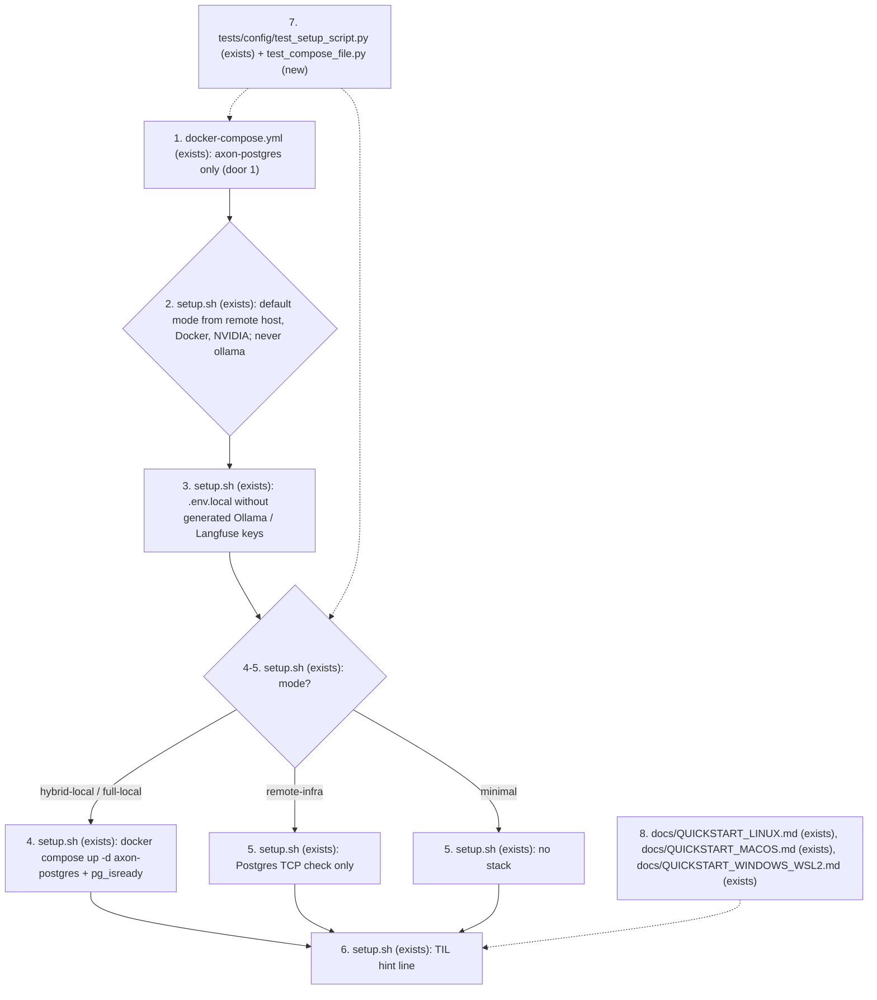

# F0.5b compose: drop the Ollama services, keep the Postgres service byte-identical

**Approved**: 2026-11-26 - Sammy (via Otto, e5576019-efb5-4945-983f-4a6bd00993b2; Parker bed733c5), user: "Aprovo (Recommended)" to "aprova a construção pelo Dani, com PR em rascunho e revisão da Rita?"

- What: plan r3, chain 20261126-axon-competitive, roadmap item F0.5 (compose part), split out as F0.5b by Otto (message 77b92746). Owner: Pietro. Status: r3 after Vera's r2 delta (FAIL, 1 medium, 1 low) and Ines's r2 delta (PASS); for Vera's check of those two points (setup.sh logic is unchanged in r3, see Revision 3 delta), then Otto, then Sammy.
- SHA-256: in the result to Otto and in Pietro's work/20261126-axon-competitive/RESULT.md.
- Repo: `sammyjdev/axon` (covered on ClaudeBot `main`). Base: `master` at `f898c82d9746f28c309247416c98f771a201dbc2`. Proposed branch: `chore/f0-5b-compose-no-ollama`. Draft PR; merge is Sammy's.
- Complexity: low - one compose file, one shell script (its mode rule, `.env.local` keys, stack commands and dead code), its test files and three quickstarts. Not a data-loss path by construction: the Postgres service (image, volume, port, environment) stays byte-identical (criteria 1-2), so no existing volume is touched, and a user's existing `.env.local` keys are kept.
- Flags: infra - Docker compose and the bootstrap script (`setup.sh`) change (Ines's trigger: container, environment). Not security, not database (no schema, query or data change).
- Builder: Dani (infra flag).
- Reviewers: Vera (plan, critic gate); **Ines** (infra: plan-stage review before Sammy approves, and the PR); Rita (code).
- Tests: atdd - recorded decisions exist: roadmap F0.5 "compose without pgvector/Ollama" (approved with D1-D8), Otto's scope for F0.5b (77b92746), dec-138 (no embeddings, no LLM in the capture path), dec-137 (compression removed); `tests/config/test_setup_script.py` already pins `setup.sh`.
- Authorization: Sammy via Parker 31e511a9, "Aprovo todas (Recommended)" (D1-D8, 2026-11-26); Otto's dispatch 448a7d26 and his F0.5b request 77b92746. Sammy's approval of this plan is required before any build. Not approved: changing the Postgres image or any database object, deleting `./data/ollama` or any volume, merge.
- Inputs read: `ROADMAP-axon.md` sha256 9d0c14ad8d3f1f71a1c6914ade9c5fe34af2da745e0c286f3400a7cc276a6300; `state.md` 29a9c81144e35144bb4abeb3ae6bcab432946b548a778d3795acecd2c9a2e6a2.

## Problem

`docker-compose.yml` still defines two Ollama services (`ollama`, profile `gpu`, `:15-35`; `ollama-cpu`, profile `cpu`, `:37-50`), and `setup.sh` starts them (`docker compose --profile "$COMPOSE_PROFILE" up -d`, `:229`), creates `data/ollama` (`:225`), health-checks Ollama on port 11434 locally and remotely (`:217`, `:240`) and pulls `phi3:mini` plus `gemma4` models (`:243-256`, list from `build_setup_plan`, `src/axon/config/platform.py:201-215`). Those models served compression (removed, dec-137) and embeddings (removed, dec-138). The only live Ollama user is the opt-in vault TIL hook, which calls `http://localhost:11434/api/chat` with `gemma4:e4b` (`src/axon/vault/til_promoter.py:17-18`). A new user who runs `setup.sh` downloads several GB of models and runs a container AXON's core does not use; the quickstarts describe that as required (`docs/QUICKSTART_LINUX.md:34-35`, `docs/QUICKSTART_MACOS.md:34`, `docs/QUICKSTART_WINDOWS_WSL2.md:36-37`). `setup.sh` also picks its default mode from whether `ollama` is installed (`setup.sh:30` -> `platform.py:166-175`), so a Docker host without `ollama` never gets `full-local` and a host with `ollama` but no Docker tries to start the stack, and it writes `OLLAMA_*`, `AXON_OLLAMA_*` and `LANGFUSE_HOST` keys into `.env.local` (`setup.sh:143-147` -> `platform.py:251-271`), where `AXON_OLLAMA_REMOTE_HOST` keeps steering the mode recommendation (`runtime.py:556`, `platform.py:164`).

The Postgres service uses `pgvector/pgvector:pg16` (`docker-compose.yml:4`). Existing volumes are likely to hold pgvector objects: AXON created the `vector` extension and the `embeddings` table in code (commits 4f320a5, 005a6ea, 2022994 in `git log -S "CREATE EXTENSION IF NOT EXISTS vector"`), and no migration at f898c82d drops either (`src/axon/store/migrations/pg/0007_identity_and_kind.sql:3-12` still alters `embeddings` if it exists; state.md: the table held 578 MB of a 610 MB database). A plain `postgres:16` image cannot load the `vector` library for those objects. Who pays for a careless swap: every existing user, with a database that starts but holds objects it cannot read.

When this ships, `setup.sh` starts only Postgres, pulls no model, picks its default mode without looking at `ollama`, writes no Ollama or Langfuse keys into a new `.env.local`, and tells the user how to enable the optional TIL hook and clean up old Ollama containers. The Postgres service, and therefore every existing volume, is unchanged.

## Shape

Reuses the existing Postgres service definition untouched and the existing `setup.sh` flow; the rules are which commands `setup.sh` runs, how it picks its default mode, and which keys it generates for `.env.local`, all in the script, reached by `tests/config/test_setup_script.py` (fake `docker`, `curl`, `nvidia-smi`, `sysctl` on `PATH`). `src/axon/config/platform.py` stays unchanged (it is pinned by `tests/config/test_platform.py`, including `:69-71` for `_to_dotenv`).

1. `docker-compose.yml` (exists) - the `ollama` and `ollama-cpu` services are deleted; `axon-postgres` keeps every line and gains a comment above the image line (door 1).
2. `setup.sh` (exists) mode resolution (`resolve_setup_mode`, `:13-39`) - an explicit mode (env or `axon.toml`) wins as today; otherwise: `remote-infra` when `AXON_INFRA_HOST`/`AXON_DESKTOP_HOST` is set; `full-local` when Docker is on `PATH` and the platform has an NVIDIA GPU with `max_models >= 2` (VRAM >= 16 GB, `platform.py:58-71,171`); `hybrid-local` when Docker is on `PATH`; `minimal` otherwise. Whether `ollama` is on `PATH` never changes the result (today it does, `setup.sh:30` -> `platform.py:166-175`). The rule reads only the explicit mode, the two host variables, Docker on `PATH` and `detect_platform()`; it does not call `build_doctor_report` and does not read `runtime.ollama_remote_host`, so an `AXON_OLLAMA_REMOTE_HOST` kept in an old `.env.local` (loaded by `runtime.py:16`) cannot force `remote-infra` (`platform.py:164`).
3. `setup.sh` (exists) `.env.local` generation (`:141-176`) - the lines `_to_dotenv` generates for `OLLAMA_*`, `AXON_OLLAMA_LOCAL_HOST`, `AXON_OLLAMA_REMOTE_HOST` and `LANGFUSE_HOST` (`platform.py:251-271`) are dropped before the merges; keys already in a user's `.env.local` are kept (user data), and the quickstarts say how to remove them.
4. `setup.sh` (exists) local-stack branch - prints `==> Subindo Postgres (docker compose up -d axon-postgres)`, runs `docker compose up -d axon-postgres` (no `--profile`), keeps the `pg_isready` check, no `mkdir data/ollama`, no Ollama health check, no `ollama pull`; the now-unused `check_service` function, `COMPOSE_PROFILE` assignments, `PLAN_COMPOSE_PROFILE` / `PLAN_PULL_MODELS` reads and the `gemma4:26b` hardware branch are removed; `resolve_setup_plan` (`:41-66`) prints only the two fields still read (`start_local_stack`, `validate_remote_services`), so the `read -r` at `:98` receives exactly two tab-separated fields; and the platform detection lines it prints (`Mac detectado`, `PC detectado`) stay.
5. `setup.sh` (exists) remote-infra branch - keeps the Postgres TCP check, drops the Ollama probe; the `remote-infra` and `minimal` messages say `Docker local será ignorado.` instead of mentioning model pulls.
6. `setup.sh` (exists) end of run - prints the TIL hint line (criterion 7).
7. `tests/config/test_setup_script.py` (exists) - `_run_setup` no longer installs a fake `ollama` by default, takes the tools that must be absent from `PATH`, a fake `nvidia-smi` VRAM value and a `docker` exit code; assertions updated to criteria 3-8 and 10-12; new `tests/config/test_compose_file.py` (new) pins criteria 1-2.
8. `docs/QUICKSTART_LINUX.md` (exists), `docs/QUICKSTART_MACOS.md` (exists), `docs/QUICKSTART_WINDOWS_WSL2.md` (exists) - setup paragraphs replaced, the Linux intro corrected (criterion 9).



**Changes underneath**

| Front | What changes |
| --- | --- |
| domain | the default `AXON_RUNTIME_MODE` that `setup.sh` writes no longer depends on `ollama`; `full-local` still requires Docker plus an NVIDIA GPU with `max_models >= 2`, as in `platform.py:171`; runtime capability labels that read the mode (`runtime.py:308-325`) see the same values as before on hosts that had `ollama` |
| stored data | nothing in Postgres: the volume `./data/axon-postgres` and its image are unchanged; `./data/ollama` (downloaded models) is left on disk, never deleted; a new `.env.local` no longer gets the generated `OLLAMA_*` / `AXON_OLLAMA_*` / `LANGFUSE_HOST` lines, an existing one keeps its keys |
| readers | users who started the old profiles have running Ollama containers (`restart: unless-stopped`) that hold host port 11434 and become compose orphans; the quickstarts give the cleanup command and say the models stay in `./data/ollama` (criterion 9) |
| readers | `runtime.py:556` reads `AXON_OLLAMA_REMOTE_HOST` only to recommend `remote-infra` (`platform.py:164`); a fresh setup no longer writes it, so a past `AXON_INFRA_HOST` run no longer sticks the recommendation, and the setup mode rule ignores the key (criterion 12) |
| readers | `tests/config/test_setup_script.py:83-86,146,164-169,193-196,201` assert the old commands and install a fake `ollama` and a failing `nvidia-smi`; updated in the same commit (criteria 3-6, 10-12) |
| readers | `tests/test_database_survives_reboot.py:15-18` reads `docker-compose.yml` with `yaml.safe_load` and asserts `restart: unless-stopped` on `axon-postgres`; it stays green |

Data: none - no database object or volume changes.

## Surface

None - no HTTP route or consumed API changes; `setup.sh` output lines and `.env.local` keys are criteria 3-8 and 10-12.

## Landing

| One-way door | Literal shape | Alternative rejected |
| --- | --- | --- |
| 1. Keep the Postgres image and say why | comment above `image: pgvector/pgvector:pg16`: `# Kept on purpose: volumes created before dec-138 hold the pgvector "vector" extension and the retired "embeddings" table, which plain postgres:16 cannot load. F1.1 makes Postgres optional; the image changes with it.` | `postgres:16` now (the roadmap's literal wording): needs a dump/restore or a `DROP TABLE embeddings; DROP EXTENSION vector` on every existing database first - a data deletion (database flag, Dale, Sammy's go-ahead) that F1.1 makes unnecessary within weeks; Otto's scope allows "keep the image but document why" |

- Nothing else in this change is hard to reverse

## Criteria

### S1: compose holds only Postgres, unchanged (P1)

**Acceptance Criteria**

1. The compose file SHALL define exactly one service, `axon-postgres`, with and without the old profiles enabled
   - Verify: new `tests/config/test_compose_file.py::test_only_postgres_is_defined` - reads docker-compose.yml as text and asserts 0 case-insensitive occurrences of `ollama`; and `::test_compose_config_lists_only_postgres` - runs `docker compose -f docker-compose.yml --profile cpu --profile gpu config --services` (the explicit `-f` keeps a local docker-compose.override.yml, `.gitignore:72`, out) and asserts the exit code is 0 and the output is exactly `axon-postgres`.
   - Red at f898c82d: the text test finds 24 case-insensitive occurrences of `ollama` on 14 lines (15-50); the config command lists `axon-postgres`, `ollama`, `ollama-cpu`.
2. The `axon-postgres` service SHALL keep image `pgvector/pgvector:pg16`, port `5433:5432`, volume `./data/axon-postgres:/var/lib/postgresql/data`, environment `POSTGRES_USER=axon`, `POSTGRES_PASSWORD=axon`, `POSTGRES_DB=axon` and `restart: unless-stopped`, and SHALL carry the door-1 comment above the image line
   - Verify: two tests. `test_compose_file.py::test_postgres_service_is_unchanged` (static, no skip marker, runs everywhere) asserts the literal port and volume strings, the image, the environment values, the restart policy and the comment on the raw text and on `yaml.safe_load` of the file. `test_compose_file.py::test_compose_config_keeps_postgres_unchanged` (Docker, criterion 13's skip rule) asserts on `docker compose -f docker-compose.yml config --format json` the normalized form: one port with `str(published) == "5433"` and `target == 5432`, one volume with `Path(source).resolve() == (REPO_ROOT / "data" / "axon-postgres").resolve()` and `target == "/var/lib/postgresql/data"`, the image, the three environment values and the restart policy.
   - Red at f898c82d: the comment is absent (the values already match: guard against an accidental image or volume change).
13. WHILE the environment variable `CI` is set, IF `docker compose` cannot run THEN the two Docker tests, `test_compose_config_lists_only_postgres` and `test_compose_config_keeps_postgres_unchanged`, SHALL fail (never skip); WHILE `CI` is unset, those two SHALL skip with the reason `docker compose v2 not available` when it cannot run; the two static tests, `test_only_postgres_is_defined` and `test_postgres_service_is_unchanged`, SHALL carry no skip marker and always run
   - Verify: only the two Docker tests use `pytest.mark.skipif(not os.environ.get("CI") and not _compose_runs(), reason=...)`, and the two static tests carry no `skip` / `skipif` marker and call no `pytest.skip`; `test_compose_file.py::test_ci_never_skips_compose` asserts, with `CI=1` and `PATH` without `docker` (monkeypatched), that `_compose_runs()` returning `False` makes the config helper raise `AssertionError` mentioning `docker compose`.
   - Red at f898c82d: the file does not exist.

### S2: setup starts only Postgres, pulls nothing, picks its mode without Ollama (P1)

**Acceptance Criteria**

3. WHEN `setup.sh` runs in `hybrid-local` mode (macOS faked) or `full-local` mode (Linux) THEN the command log SHALL contain `docker compose up -d axon-postgres` and `docker compose exec -T axon-postgres pg_isready`, stdout SHALL contain `==> Subindo Postgres (docker compose up -d axon-postgres)`, and the log SHALL contain 0 occurrences of `--profile`
   - Verify: updated `test_setup_script.py::test_setup_defaults_to_recommended_hybrid_local_mode_on_mac` and `::test_setup_full_local_without_nvidia_keeps_small_models_only` (renamed `..._starts_only_postgres`).
   - Red at f898c82d: the log holds `docker compose --profile cpu up -d` and stdout holds `com profile: cpu`.
4. The setup script SHALL run 0 `ollama` commands in every mode (`hybrid-local`, `full-local`, `remote-infra`, `minimal`), and `grep -c -e 'COMPOSE_PROFILE' -e 'PULL_MODELS' -e 'check_service' -e 'gemma4:26b' -e 'pull de modelos' -e 'com profile' setup.sh` SHALL print `0`
   - Verify: each of the 4 mode tests installs a logging fake `ollama` and asserts `ollama ` is absent from the command log; the grep runs in `test_setup_script.py::test_setup_has_no_profile_or_model_residue`.
   - Red at f898c82d: `ollama pull phi3:mini` and `ollama pull gemma4:e4b` are in the hybrid-local and full-local logs; the grep prints `18`.
5. WHEN `setup.sh` runs in `remote-infra` mode with `AXON_INFRA_HOST=desktop.local` THEN stdout SHALL contain `Postgres` and the command log SHALL contain 0 occurrences of `11434`
   - Verify: updated `test_setup_script.py::test_setup_uses_remote_infra_when_host_is_configured` (the assertion on the curl probe of desktop.local port 11434 is inverted).
   - Red at f898c82d: the log holds the curl probe of desktop.local port 11434 (`test_setup_script.py:146`).
6. WHEN `setup.sh` runs in `hybrid-local` or `full-local` mode THEN the workspace SHALL contain no `data/ollama` directory afterwards
   - Verify: `assert not (workspace / "data" / "ollama").exists()` in both the hybrid-local and the full-local test.
   - Red at f898c82d: `mkdir -p data/ollama` creates it in both.
7. WHEN `setup.sh` finishes in any mode THEN stdout SHALL contain the TIL hint line, Appendix A line 1, character for character
   - Verify: asserted in all 4 mode tests (the remote-infra test without a host exits 1 earlier and is not asserted).
   - Red at f898c82d: the line is absent.
8. IF `docker compose up -d axon-postgres` exits non-zero THEN `setup.sh` SHALL exit non-zero (unchanged `set -euo pipefail`, `setup.sh:2`)
   - Verify: new `test_setup_script.py::test_setup_fails_when_compose_fails` (`_run_setup(..., docker_exit_code=1)` makes the fake `docker` exit 1).
   - Red at f898c82d: passes today through `set -e` (guard). Deliberate break: `docker compose up -d axon-postgres || true` turns it red.
10. WHEN no mode is configured and `ollama` is not on `PATH` THEN `setup.sh` SHALL pick `full-local` on Linux with Docker on `PATH` and a fake `nvidia-smi` reporting `24576` (MB), and `hybrid-local` on Linux with Docker and a failing `nvidia-smi`
    - Verify: new `test_setup_script.py::test_default_mode_ignores_ollama` (parametrized; `_run_setup(..., absent={"ollama"}, nvidia_vram_mb=24576)`); `.env.local` holds `AXON_RUNTIME_MODE=full-local` and `AXON_RUNTIME_MODE=hybrid-local` respectively.
    - Red at f898c82d: with `ollama` absent the first case gives `hybrid-local` (`platform.py:171` needs `ollama_available`).
11. WHEN no mode is configured, `docker` is not on `PATH` and `ollama` is THEN `setup.sh` SHALL pick `minimal` and run no `docker` command
    - Verify: new `test_setup_script.py::test_no_docker_with_ollama_is_minimal` (`_run_setup(..., absent={"docker"}, present={"ollama"})`; the test's `PATH` holds only its fakes and links to the core tools `setup.sh` needs, so a real `docker` on the runner is not found).
    - Red at f898c82d: `hybrid-local` is picked (`platform.py:173`), and the run tries `docker compose`.
12. WHEN `setup.sh` runs with `AXON_INFRA_HOST=desktop.local` in a workspace with no `.env.local` THEN the new `.env.local` SHALL keep `AXON_INFRA_HOST=desktop.local` and SHALL contain no line matching `^(OLLAMA_[A-Z_]+|AXON_OLLAMA_LOCAL_HOST|LANGFUSE_HOST)=` and no non-empty `AXON_OLLAMA_REMOTE_HOST=` value (the empty placeholder from `.env.example:35` may stay); WHEN `.env.local` already holds "AXON_OLLAMA_REMOTE_HOST=http://old:11434" THEN that line SHALL be kept unchanged, and WHEN `setup.sh` then runs without `AXON_INFRA_HOST` / `AXON_DESKTOP_HOST` and with Docker on `PATH` THEN it SHALL pick `hybrid-local` (not `remote-infra`) and exit 0
    - Verify: new `test_setup_script.py::test_env_local_has_no_generated_ollama_keys` and `::test_existing_env_local_keys_are_kept` (which also asserts `AXON_RUNTIME_MODE=hybrid-local` and exit 0).
    - Red at f898c82d: `.env.local` holds `OLLAMA_FLASH=`, `OLLAMA_MODEL_PRIMARY=`, "LANGFUSE_HOST=http://desktop.local:3000" and "AXON_OLLAMA_REMOTE_HOST=http://desktop.local:11434".

### S3: docs match (P1)

**Acceptance Criteria**

9. The quickstarts SHALL match the new setup: `docs/QUICKSTART_LINUX.md:34-35` and `docs/QUICKSTART_MACOS.md:34` replaced by the Appendix A paragraph (local Postgres only); `docs/QUICKSTART_LINUX.md:5-6` reading `Linux is the strongest path for a full local AXON install: engine and stores on the same machine.`; and, in `docs/QUICKSTART_WINDOWS_WSL2.md` (remote-infra: it checks the remote Postgres and starts no local stack), the sentence starting `It also probes Ollama on port` (`:37-38`) deleted and nothing else changed
   - Verify: `grep -c -e '--profile' -e 'pulls the default Ollama' -e 'CPU profile' -e 'probes Ollama' -e 'local models on the same machine' docs/QUICKSTART_LINUX.md docs/QUICKSTART_MACOS.md docs/QUICKSTART_WINDOWS_WSL2.md` prints `0` for each file; `grep -c 'remove-orphans' docs/QUICKSTART_LINUX.md docs/QUICKSTART_MACOS.md` prints `1` for each; `grep -c 'remove-orphans' docs/QUICKSTART_WINDOWS_WSL2.md` prints `0`.
   - Red at f898c82d: the first grep prints `2` for Linux (`pulls the default Ollama`, `local models on the same machine`), `1` for macOS (`CPU profile`) and `1` for WSL2 (`probes Ollama`).

## Appendix A - literal texts

Line 1, the TIL hint `setup.sh` prints at the end of every run:

```text
Optional TIL hook: install Ollama (https://ollama.com) and run: ollama pull gemma4:e4b
```

The quickstart paragraph (criterion 9, Linux and macOS):

```text
setup.sh writes .env.local and starts the local Postgres container (docker compose up -d axon-postgres). It pulls no model. The optional vault TIL hook needs Ollama on the host: install it from https://ollama.com and run ollama pull gemma4:e4b. If an older setup started the Ollama containers, they keep host port 11434 busy until you run docker compose up -d --remove-orphans; that removes them, while the downloaded models stay in ./data/ollama until you delete that folder. Older .env.local files may still hold OLLAMA_*, AXON_OLLAMA_* and LANGFUSE_HOST lines that AXON no longer needs; you can delete them.
```

## Build steps

1. Write `tests/config/test_compose_file.py` and update `tests/config/test_setup_script.py` (including the new `_run_setup` parameters) for criteria 1-8 and 10-13; verify: `python3 -m pytest tests/config/test_compose_file.py tests/config/test_setup_script.py -q -rs` with `CI=1` on Linux with Docker Compose v2 and bash fails at f898c82d on criteria 1-7 and 10-13, with 0 skipped tests.
2. Edit `docker-compose.yml`; verify: criteria 1-2 pass, and in a clean checkout (no `docker-compose.override.yml`) `git show f898c82d:docker-compose.yml > /tmp/base.yml; diff <(docker compose -f /tmp/base.yml --project-directory . config) <(docker compose -f docker-compose.yml config)` prints nothing (default profiles: only `axon-postgres` resolves in both).
3. Edit `setup.sh` (mode rule, `.env.local` filter, local-stack and remote branches, dead code); verify: criteria 3-8 and 10-12 pass.
4. Edit the three quickstarts; verify: the criterion 9 greps.
5. Run the gate; verify: `ruff check src && python3 -m pytest -q` exits 0 (CI full-suite job on ubuntu-latest green on the PR head; `tests/config` also runs in the matrix job, `ci.yml:63`, both with `CI` set by GitHub Actions, so the compose tests cannot skip there).

## Rollback

- The change touches no volume or database object, so a rollback is `git revert` of the merge commit; `docker compose --profile cpu up -d` then starts the old Ollama container again, reusing the models still in `./data/ollama`.
- Postgres continuity is proven by identity (criterion 2 and build step 2: the resolved service config is the same as at f898c82d), not by a dump/restore, because nothing in the service changes.
- `.env.local` files written after the change lack the Ollama and Langfuse keys; after a revert, the next `setup.sh` run writes them again.

## Dependencies

- Other F0 items: none. F0.5 (docs, Jay) edits `README.md` and other docs, not these files; no shared file, so the two PRs merge in either order. F0.4 (D1) is NOT a dependency (it does not touch compose or setup).
- Later: F1.1 (embedded storage, ADR) owns the Postgres image decision (door 1's comment names it), `platform.py`'s Ollama fields and the testcontainers image.
- Tools: Docker Compose v2 (`docker compose config --format json`, `--services`) and bash on the CI runner (ubuntu-latest ships both; the matrix and full-suite jobs set `CI`, so the compose tests fail rather than skip if Compose is missing); no new dependency.

## Out of scope

| Excluded | Why |
| --- | --- |
| Swapping to `postgres:16`, dropping `embeddings` or the `vector` extension | data change on existing databases; F1.1 replaces the default backend (door 1) |
| `platform.py` (`build_setup_plan`, `_to_dotenv`, `_recommend_operating_mode`, `ollama_available` in the doctor report) | pinned by `tests/config/test_platform.py`; `setup.sh` stops depending on its Ollama parts (criteria 10-12), and `axon doctor` still shows `ollama: ok/missing` as a host fact; cleanup with F1.1 setup work |
| `setup.sh` "next steps" lines (`ANTHROPIC_API_KEY`, `pb index`, `pb ask`, `:265-272`) | stale but not compose; follow-up card F0.5c (or F1.3 install docs) |
| The testcontainers image `pgvector/pgvector:pg16` (`tests/conftest.py:203` and the per-file `PostgresContainer` fixtures: `git grep -l "pgvector/pgvector:pg16" -- tests` lists 27 files at f898c82d) | same image as compose by design; changes with F1.1 |
| Removing keys from existing `.env.local` files | user data; the quickstarts say they can be deleted (Appendix A) |
| Deleting `./data/ollama` or running `--remove-orphans` from `setup.sh` | user data and running containers; the quickstarts give the command instead of removing anything unannounced |

## Assumptions

| Assumption | Chosen default | Rationale | Confirmed? |
| --- | --- | --- | --- |
| Existing volumes hold the `vector` extension and possibly the `embeddings` table | keep the image (door 1) | created in code (git log above), dropped by no migration; keeping the image is safe whether or not they exist | y - Ines confirmed at plan review (`review-ines.md`, section 1) |
| The roadmap's "without pgvector" is satisfied by documenting the kept image until F1.1 | yes | Otto's F0.5b scope allows "keep the image but document why"; minimal before F1.1 | n - Sammy confirms by approving this plan |
| Ollama users in the code | the TIL hook calls `localhost:11434` (`src/axon/vault/til_promoter.py:17`); `platform.py:267-269` generates `AXON_OLLAMA_LOCAL_HOST`, `AXON_OLLAMA_REMOTE_HOST` and `OLLAMA_HOST` for `.env.local`; `runtime.py:556` reads only `AXON_OLLAMA_REMOTE_HOST`, to recommend `remote-infra` | `git grep -n 11434 src/` at f898c82d returns those 4 lines in 2 files; nothing reads `OLLAMA_MODEL_*`, `OLLAMA_FLASH` or `LANGFUSE_HOST` | n - Vera can rerun the grep |
| `docker compose --profile cpu --profile gpu config --services` exits 0 when no service declares a profile | yes | Ines: services without `profiles:` are always active in Compose v2 (`review-ines.md`, section 1); criterion 1 asserts the exit code in CI | n - CI output on the PR |
| Old Ollama containers keep port 11434 until removed | documented cleanup command (Appendix A) | they were started with `restart: unless-stopped` and `11434:11434` (`docker-compose.yml:21,35,43,50`); host `ollama serve` cannot bind while they run | y - Ines (`review-ines.md`, I-F05B-3) |

**Open questions:** none - all resolved or logged above.

**Not verifiable on Linux CI:** a real pre-existing volume with Sammy's data (covered by the config-identity proof instead), real macOS and GPU hosts (CI fakes `OSTYPE=darwin23`, `sysctl` and `nvidia-smi`), and `docker compose up -d --remove-orphans` against real old Ollama containers (documented step; Ines or Sammy can run it once on a machine that has them).

## Differences from the source

None - the product matches the source (roadmap F0.5 compose part as scoped by Otto in 77b92746), with the Postgres image kept as Otto's scope allows (door 1).

## Gate

Command: `ruff check src && python3 -m pytest -q`

## Sources

- `ROADMAP-axon.md` F0.5 (sha256 9d0c14ad...) - binding (approved with D1-D8).
- Otto's F0.5b request, message 77b92746 - binding - scope and the keep-the-image option.
- Code at f898c82d: `docker-compose.yml:1-50`, `setup.sh:1-273`, `src/axon/config/platform.py:40-71,105-126,155-216,251-271`, `src/axon/config/runtime.py:308-325,556`, `src/axon/vault/til_promoter.py:17-18`, `src/axon/store/migrations/pg/0007_identity_and_kind.sql:1-12`, `tests/config/test_setup_script.py:55-250`, `tests/test_database_survives_reboot.py:15-18`, `docs/QUICKSTART_LINUX.md:3-6`, `tests/conftest.py:188-207`, `docs/QUICKSTART_LINUX.md:34-35`, `docs/QUICKSTART_MACOS.md:34`, `docs/QUICKSTART_WINDOWS_WSL2.md:36-37`; `git log -S "CREATE EXTENSION IF NOT EXISTS vector"` (4f320a5, 005a6ea, 2022994).
- Gate: CI `.github/workflows/ci.yml`; `CLAUDE.md` lines 139-140.

## Revision 2 delta

Sources: Vera's critic review `critic-vera.md` (sha256 cbfc7d06fabef29cd63c60985d93525522232834c81ae24ca5e7d82605903f3e; FAIL, 2 high, 3 medium, 1 low) and Ines's infra review `review-ines.md` (sha256 3416302eefd08f63b0fe3590241144be84c155ba764f28bab46fc600dbb4dca7; PASS, 3 low notes), relayed by Otto (7774f434). r1 is kept byte-identical as `plan.r1-7efb2e39.md`; `rev1-to-rev2.diff` is the full delta. Each finding was confirmed against the code at f898c82d before the fix.

Infra steps changed since Ines's PASS: `setup.sh` now also changes its default-mode rule (criteria 10, 11) and stops generating Ollama / Langfuse keys for `.env.local` (criterion 12). Compose, the Postgres service and the rollback are as in r1. Whether that needs Ines's recheck is Otto's call.

Changed: the What and Complexity lines, the first and last paragraphs of Problem, Shape, Surface, Criteria (S1-S3), Appendix A (quickstart paragraph), Build steps, Rollback (one bullet added), Dependencies, Out of scope, Assumptions, the "Not verifiable" note, Sources. Unchanged: the rest of the header, the second Problem paragraph, Landing, Differences from the source, Gate.

Meaning changed: criteria 1, 2, 3, 4, 6 and 9 are stricter (exit code and `-f`; normalized JSON; the banner line; the residue grep; full-local too; the Linux intro and the WSL2 wording); criteria 10-13 are new; criteria 5, 7 and 8 keep their r1 meaning (8 gets the `docker_exit_code` hook it needed).

| Reviewer, id | Finding | Confirmed at f898c82d | Change in r2 | Criteria |
| --- | --- | --- | --- | --- |
| Vera 1 (H) | `setup.sh:30` still picks the default mode from `ollama`'s presence; the test's fake `ollama` hides it | `setup.sh:26-34`; `platform.py:166-175` (`:171`, `:173`); `test_setup_script.py:193-196,201` | mode rule without `ollama` (Shape step 2); fake `ollama` no longer default; NVIDIA and no-Docker cases tested | 10, 11 |
| Vera 2 (H) | Assumption row 3 false; `.env.local` gets sticky `AXON_OLLAMA_REMOTE_HOST` and `OLLAMA_*` / `LANGFUSE_HOST` | `platform.py:251-271` (`:267-269`); `setup.sh:141-176`; `runtime.py:556`; `platform.py:164` | row corrected (4 lines in 2 files); `setup.sh` drops the generated keys, keeps a user's existing ones, quickstarts say they can go | 12 |
| Vera 3 (M) | compose test: no CI vs local policy, JSON normalization, override file | `test_setup_script.py:55-68`; `.gitignore:72` | skip only when `CI` is unset; fail under `CI`; normalized JSON assertions; explicit `-f docker-compose.yml`; exit code asserted | 1, 2, 13 |
| Vera 4 (M) | misleading `com profile` banner and dead profile / pull code; criterion 6 misses full-local | `setup.sh:98,100-130,213,221,228,244-256` | banner `Subindo Postgres (...)`; residue grep must print 0; full-local asserts no `data/ollama` | 3, 4, 6 |
| Vera 5 (M) | Linux intro still promises local models; criterion 9 over-generalizes WSL2 | `QUICKSTART_LINUX.md:5-6`; `QUICKSTART_WINDOWS_WSL2.md:36-38` | intro corrected; criterion 9 separates local Postgres (Linux, macOS) from remote-infra (WSL2) | 9 |
| Vera 6 (L) | `14` vs `24` occurrences; `conftest.py:199` vs `:203`; per-file test images | `grep -io ollama docker-compose.yml` = 24 on 14 lines; `tests/conftest.py:203`; 27 files with the image | counts and refs fixed; per-file fixtures noted for F1.1 | 1 |
| Ines I-F05B-1 (L) | `config --format json` normalizes ports and volume sources; no `skipif` on Compose | Compose v2 JSON output (Ines) | normalized assertions; skip never applies under `CI` | 2, 13 |
| Ines I-F05B-2 (L) | `check_service()` and `COMPOSE_PROFILE` become unused; criterion 8 needs an injectable `docker` failure | `setup.sh:98,104-130,181-189`; `test_setup_script.py:189-192` | dead code removed (residue grep); `_run_setup(docker_exit_code=...)` | 4, 8 |
| Ines I-F05B-3 (L) | orphaned Ollama containers hold port 11434 until `--remove-orphans`; `./data/ollama` stays | `docker-compose.yml:21,35,43,50` | both documented in the quickstart paragraph and in Changes underneath | 9 |

## Revision 3 delta

Source: Vera's `critic-vera.md` section "r2 delta" (file sha256 f9c1568f56806d50795f4f7769748c2eccd9b24f9ee2a5ca75ed3abb5913d909; FAIL, 1 medium, 1 low; all r1 items closed) and Ines's r2 delta (PASS), relayed by Otto (30a3fffb). r2 is kept byte-identical as `plan.r2-6f569667.md`; `rev2-to-rev3.diff` is the full delta.

`setup.sh` logic is unchanged in r3: Shape steps 2 and 4 only state explicitly what r2's rule already implied (no `build_doctor_report`, `resolve_setup_plan` trimmed to the fields still read); criterion 12 gains a test of that existing rule. Compose, the Postgres service and the rollback are as in r2.

Meaning changed: criterion 2 (its checks split into a static test and a Docker test), criterion 13 (names the four tests and which two may skip) and criterion 12 (adds the old-key mode case). All other criteria keep their r2 meaning.

| Finding (Vera r2 delta) | Change in r3 | Criteria |
| --- | --- | --- |
| MEDIUM: criterion 2's single test mixed static and Docker checks, so criterion 13's skip rule would skip the static checks too | `test_postgres_service_is_unchanged` holds only static checks and never skips; `test_compose_config_keeps_postgres_unchanged` holds the Docker JSON checks under the skip rule; criterion 13 names the two Docker tests (skip only when `CI` is unset) and the two static tests (no skip marker) | 2, 13 |
| LOW (a): `build_doctor_report` returns `remote-infra` when a kept `.env.local` holds `AXON_OLLAMA_REMOTE_HOST` | Shape step 2 says the mode rule does not call `build_doctor_report` or read `ollama_remote_host`; criterion 12 tests a kept key without `AXON_INFRA_HOST` -> `hybrid-local`, exit 0 | 12 |
| LOW (b): `resolve_setup_plan` still prints the removed fields into `read -r` | Shape step 4: `resolve_setup_plan` prints only `start_local_stack` and `validate_remote_services`; criteria 3-8 and 10-12 run the script end to end | 3-8, 10-12 |
| LOW (c): Changes underneath cited criterion 11 for the sticky key | now criterion 12 | n/a |
