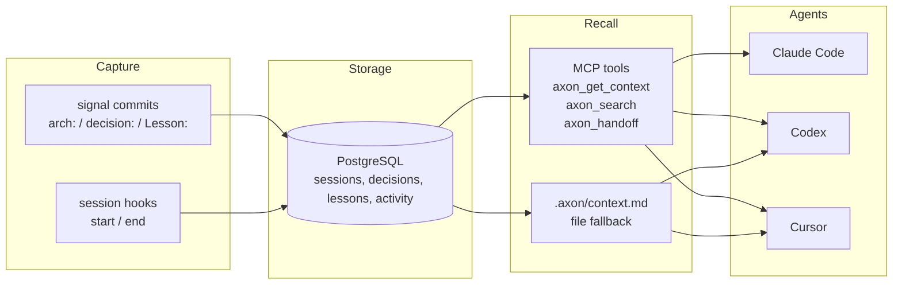

# AXON


**Same context, any AI coding agent.**

> *Agent-agnostic eXecution and cONtext Network.*

Every time you switch coding agents — from Claude Code to Codex to Cursor — or
resume a project after a few days away, your AI assistant starts blank. AXON
solves this by capturing context at the moments it crystallises (git commits,
session boundaries) and surfacing it on demand over MCP or a plain
`.axon/context.md` file that any agent can read. One install, continuous memory,
any agent.

---

## What AXON keeps

AXON is the memory of the work you do with coding agents: the decisions you
make, the lessons from mistakes, a digest of each session and the activity
history of Claude Code, Codex and agy. It does not index or embed code - agents
read code with their own tools, and AXON holds what the code cannot say
([dec-138](docs/decisions/dec-138-stop-code-vectors.md)). No commit and no MCP
tool calls an LLM, so AXON needs no provider key.

---

## Quickstart

AXON is not yet on PyPI. Install from source:

```bash
git clone https://github.com/sammyjdev/axon.git
cd axon
pip install -e .
```

`axon doctor` reports the whole stack.

Initialize AXON in a repo (installs its git hooks):

```bash
axon init /path/to/your-repo
```

Register the MCP server with your coding agent. For Claude Code, add this to
your project's `.claude/settings.json`:

```json
{
  "mcpServers": {
    "axon": {
      "command": "axon",
      "args": ["serve"]
    }
  }
}
```

`axon serve` runs the MCP server over stdio. Once registered, tools such as
`axon_get_context`, `get_session_memory`, `axon_capture`, `axon_handoff`,
`axon_search`, `axon_record_lesson`, `axon_search_lessons` and `axon_health`
are available inside your agent session
([full list](docs/PROJECT_OVERVIEW.md#mcp-tools-srcaxonmcpserverpy)).

Every tool is classified by risk (`read` / `write` / `destructive`) and
emits structured trace records under a shared `trace_id` for tool-latency
and success-rate dashboards. A destructive tool requires
`AXON_ALLOW_DESTRUCTIVE=1` (or `true` / `yes` / `on`) as a consent token; none
ships today. Writes to a RESTRICTED context
(`ctx=work`) are always denied with `DENY_RESTRICTED_TOOL_WRITE`. See
[ADR-013](docs/ADR.md#adr-013-tool-risk-classification-policy-gate-and-tracing-middleware)
and [dec-109](docs/decisions/dec-109-tool-tracing-and-risk-gating.md).

---

## How it works



Capture is **event-driven only** — signal commits and agent session
start/end. No background timer, no idle cost (see
[dec-104](docs/decisions/dec-104-event-driven-not-time-driven.md)). A commit is
captured only when it says so: an `arch:` / `decision:` subject or an
`ADR-Decision:` trailer becomes a draft decision, a `Lesson:` trailer a lesson
draft ([dec-110](docs/decisions/dec-110-declarative-memory-signal.md)).

Storage is a single **PostgreSQL** instance: sessions, decisions, ADRs and
activity history live there
([dec-121](docs/decisions/dec-121-postgres-unified-storage.md)), and lessons
are found with Postgres full-text search. SQLite, Redis, Qdrant, mem0 and
pgvector were retired. Neo4j was evaluated and dropped separately
([dec-101](docs/decisions/dec-101-revoke-d4-drop-neo4j.md)).

The primary transport is **MCP (stdio)**. A `.axon/context.md` file in the repo
is kept in sync as a fallback for agents without MCP support
([dec-103](docs/decisions/dec-103-cross-agent-mcp-primary.md)).

---

## Use cases

### Agent handoff without context loss

You spend an afternoon with Claude Code, push a branch, then continue the work
in Codex the next day. Without AXON, Codex starts cold. With AXON, the MCP tool
`axon_handoff` supplies Codex with the decisions and open questions from the
previous session — no copy-pasting required.

### Multi-day project continuity

On a project that spans weeks, the important context is not your last five
messages but the architectural decisions made three sprints ago. AXON captures
decisions from signal commits and explicit captures into Postgres, so
`axon_search` and `axon_get_context` return what actually matters, not stale
history.

### Architecture docs from captured decisions

`axon export adr` and `axon export architecture` write the captured decisions
as structured Markdown notes to an Obsidian vault, turning captured context
into living documentation.

---

## How AXON compares

The closest tools are other cross-agent memory/compression layers, not the
editing agents (Aider, Cline) whose histories are built-in and single-agent:

| | AXON | claude-mem | Headroom | Supermemory |
|---|---|---|---|---|
| **Primary goal** | Decision capture + cross-agent continuity | Auto-capture of all session activity | Token compression layer | Hosted cross-agent memory API |
| **What it captures** | Decisions at crystallisation points (git / session) | Every tool use, continuously | Whatever passes through (compresses it) | Facts / observations via API |
| **Reversible compression** | No (removed, dec-137) | No | Yes (CCR cache) | No |
| **Decision capture** | Yes (commit signals and explicit captures, no LLM) | No | No (failure-driven `learn`) | No |
| **Governance** | Per-tool risk class + restricted ctx (ADR-013) | `<private>` tags | A/B holdouts / measured savings | Access controls |
| **Works across agents** | Yes (MCP + file fallback) | Yes (MCP) | Yes (wrap / proxy) | Yes (plugins) |
| **Self-hosted** | Yes | Yes | Yes | Hosted-first |

The crowded part of this space is **raw recall** — tools like
[agentmemory](https://github.com/rohitg00/agentmemory) and Hindsight publish
strong LongMemEval scores and optimise for that directly. AXON does not compete
on that axis. Its defensible niche is the intersection none of the above
combine: capturing *decisions* (not every keystroke) at git and session
boundaries, and gating
every MCP tool by risk class with a full audit trail. If you want the best raw
recall benchmark, those tools win; if you want decisions and architecture to
survive across agents and months, auditably, that is AXON.

---

## Measured results

### Current: lesson search after dec-138

[dec-138](docs/decisions/dec-138-stop-code-vectors.md) replaced pgvector with
Postgres full-text search. Measured on 2026-10-15 over the 41 real lessons:

| | Full-text search | pgvector |
|---|---|---|
| Trigger queries with the expected lesson first | 41 of 41 | 33 of 41 |
| Time per search | about 5 ms | about 600 ms |
| English task queries, expected lesson in the top 5 | 20 of 20 | 20 of 20 |
| English task queries, expected lesson first | 15 of 20 | 19 of 20 |
| Portuguese queries, expected lesson in the top 5 | 3 of 5 | 5 of 5 |

The `embeddings` table held 578 MB of a 610 MB database. dec-138 removes it, and
with it the need for a provider key and a pgvector image.

Test suite: 1,500 passed, 3 skipped (CI, 2026-10-30).

### Historical: token savings from code search

Until 2026-10-15 AXON served code search (`search_code`) and compressed the
results, and GNOMON measured both. The best-known figure, a 90.7% token reduction
against reading the same files in full (330,590 vs 3,537,838 tokens, n=333),
describes that retired subsystem, not AXON today. Code search was retired because
agents rarely used it and went back to grep when they did. The measurements stay
in [`docs/METRICS.md`](docs/METRICS.md) and the git history for provenance.

---

## Documentation

| Document | Contents |
|---|---|
| [`CLAUDE.md`](CLAUDE.md) | Architecture decisions, code conventions, agent rules |
| [`docs/ADR.md`](docs/ADR.md) | Active architectural decision records |
| [`docs/METRICS.md`](docs/METRICS.md) | Recomputed performance metrics manifest (dated) |
| [`docs/ARD.md`](docs/ARD.md) | Architectural requirements |
| [`docs/USAGE_GUIDE.md`](docs/USAGE_GUIDE.md) | CLI workflows |
| [`docs/VAULT_SETUP.md`](docs/VAULT_SETUP.md) | Obsidian vault bootstrap |
| [`docs/decisions/`](docs/decisions/) | Individual decision records (dec-100 to dec-138) |
| [`docs/decisions/dec-138-stop-code-vectors.md`](docs/decisions/dec-138-stop-code-vectors.md) | Code vectorization stopped; AXON is the memory of agent work |
| [`docs/decisions/dec-109-tool-tracing-and-risk-gating.md`](docs/decisions/dec-109-tool-tracing-and-risk-gating.md) | Tool risk classes, policy gate, tracing middleware |

---

## Contributing

Start from tests. The repo uses TDD: bugfixes begin with a regression test,
features need testable acceptance criteria before implementation.

```bash
pytest tests/ -q
```

See [`CLAUDE.md`](CLAUDE.md) for code conventions and agent rules.

---

## Author

Built by [sammyjdev](https://github.com/sammyjdev), Senior AI Engineer (Forward Deployed).

---

## License

Apache-2.0 — see [`LICENSE`](LICENSE).
